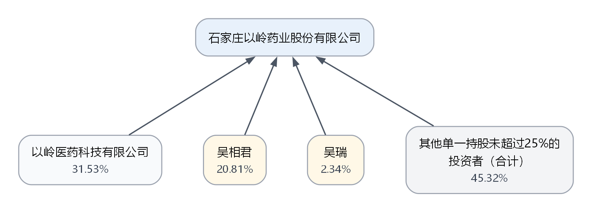
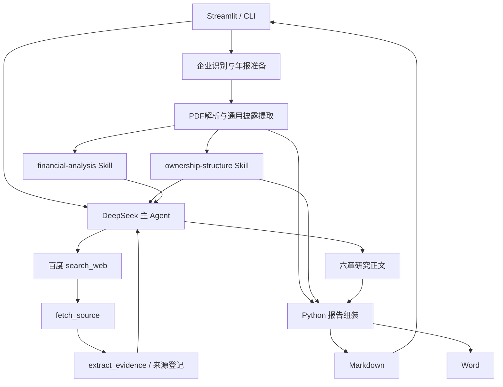

# 企业授信研究Agent

## 项目背景

在银行对公授信业务中，客户经理需要检索和整理大量企业及行业资料，了解企业的发展背景、主营业务、经营模式、产业链位置及上下游关系，并结合财务报表分析其经营状况与偿债能力。这些信息分散在企业官网、公告、行业资料和政策文件中，收集、梳理并形成分析往往需要投入大量时间。**本项目希望通过 AI Agent 辅助完成公开资料搜集、信息整理和研究分析，帮助客户经理更快建立对企业及其所处行业的认识，并为财务分析和后续尽调提供参考。** 考虑到实际授信业务涉及大量非上市企业，其财务报表、银行流水等资料通常依赖客户提供，且存在信息保密要求，本项目在开发阶段采用上市公司公开披露资料作为研究素材，用于验证研究流程与技术实现，不使用银行内部资料或客户非公开信息。

## 项目介绍

**企业授信研究Agent（Corporate Credit Research Agent）** 是一个面向 A 股非金融上市公司的公开信息研究工具。用户通过网页输入股票代码和研究指令，系统自动识别企业、获取年报并按需检索外部资料，围绕企业发展历史、业务与经营模式、产业链关系、行业政策及财务表现开展研究，最终生成企业授信研究初稿与待补充资料及尽调问题清单。系统由 **DeepSeek 负责资料理解、研究分析和报告撰写**，结合股权结构绘图与授信财务分析两个专业 Skill，由 Python 工具完成资料处理、财务指标计算、股权校验和图表绘制，并通过 Streamlit 展示研究进度与结果。项目不仅关注信息汇总，还强调从银行授信视角分析重大财务变化、可能原因及其合理性，结合关联指标提出经营与偿债风险关注点。

> 本项目定位为研究辅助工具。报告为 AI 生成的研究初稿，相关数据及结论需人工复核，不替代客户尽调或银行授信审批。

## MVP（Minimum Viable Product，最小可行产品）状态

- 已实现沪深 A 股非金融上市公司的动态主体识别、年度报告发现、下载、PDF 解析和任务级来源登记。
- 已实现企业基本面、主要股东披露、合并财务报表的通用提取，并复用 `ownership-structure` 与 `financial-analysis` 两个 Skill。
- 已接入 DeepSeek Agent Loop、百度搜索、网页/PDF 原文获取、工具预算、执行轨迹和部分成功机制。
- 已实现 Streamlit 本地网页、历史任务恢复、Markdown 展示和 Word 导出。
- 正式报告的专业分析正文由 DeepSeek 生成；Python 负责资料获取、数据结构化、确定性计算、图表和 Markdown/DOCX 组装，不使用固定模板替写模型正文。
- 当前支持范围为上交所、深交所 A 股上市公司，证券公司、银行、保险公司及北交所上市公司除外。

## 演示材料

### 真实 Live 示例

- [以岭药业完整授信研究报告](examples/live/yiling-002603-20261028/credit_research_report.md)
- [示例说明](examples/live/yiling-002603-20261028/README.md)
- [股权结构图 PNG](examples/live/yiling-002603-20261028/assets/ownership_structure.png)



该示例来自 2026-10-28 的一次真实 DeepSeek + 百度搜索 Live 任务，已经人工检查报告展示和股权图。报告仍然是公开资料驱动的 AI 初稿，不应直接用于授信审批。

### 无密钥 Mock 示例

- [完整研究 Mock 报告](examples/v2_5_complete_mock/CN-A-SZSE-002603/credit_research_report.md)

Mock 示例只验证 Agent 编排、双 Skill 调用、报告文件和界面展示，不代表真实模型研究质量，也不等同于 Live 验收。

## 核心功能

1. **自动化企业研究流程**

   用户输入上交所、深交所 A 股上市公司的股票代码和研究要求后，Agent 自动识别企业、获取年报并按需检索公开资料，组织后续分析，减少人工搜集、整理和汇总信息的工作量。当前暂不支持证券、银行和保险公司。

2. **企业背景与发展脉络梳理**

   基于公开资料，梳理企业的成立背景、改制上市、并购重组、业务转型及其他已发生的重要事件，形成截至研究日的发展脉络，帮助用户理解企业的历史沿革与业务演变。

3. **主营业务与经营模式分析**

   分析企业的主营业务、主要产品、采购与生产方式、销售渠道及盈利模式，并梳理企业在产业链中的位置和上下游关系，帮助用户理解企业如何开展业务、实现收入及形成资金需求。

4. **股权结构可视化**

   根据公开披露的股东信息，在后台完成股权关系整理、持股比例校验与分层绘图，并将股权结构图插入报告。资料不足或无法生成图表时跳过该部分，不阻断其他研究内容的生成。

5. **行业环境与政策研究**

   检索行业发展趋势、竞争格局、扶持政策及监管要求，结合企业所属行业和实际业务，分析外部环境可能带来的经营机会与风险。

6. **授信视角的财务分析**

   结合财务报表、可获得的财务附注及指标计算结果，分析盈利能力、资产负债结构和偿债能力。重点关注货币资金、应收账款、应付账款等科目，按照“金额变化 → 原因分析 → 合理性判断 → 授信关注点”开展分析，并通过跨指标比较理解企业经营与资金周转状况，而非仅罗列财务数据。

7. **授信关注点与尽调问题整理**

   综合企业经营、行业环境和财务表现，提出经营稳定性、盈利持续性、资金周转、流动性及偿债压力等方面的关注点，并根据实际信息缺口形成有针对性的待补充资料与尽调问题清单。

8. **研究报告生成、展示与导出**

   由 DeepSeek 基于研究资料撰写企业授信研究报告，通过网页展示任务进度、分析正文、财务表格及股权图，并支持导出 Word 文档。不确定信息简要标注“未核验”，便于用户阅读和后续复核。

## 架构与职责分工



| 组件 | 主要职责 |
| --- | --- |
| DeepSeek 主 Agent | 理解任务、选择工具、组织检索、分析资料并撰写正式报告正文 |
| SkillRegistry / SkillLoader | 白名单登记、运行时读取并校验两个 `SKILL.md` |
| `ownership-structure` | 规定股权披露核验和绘图方法；完整报告中不驱动常规股权文字分析 |
| `financial-analysis` | 规定银行授信视角下的财务分析框架和尽调要求 |
| Python Tools | 企业识别、年报/PDF/网页获取、结构化提取、计算、校验、缓存、绘图和文件组装 |
| Streamlit | 用户交互、显式 Live 确认、后台任务状态、报告查看和下载 |

### 研究流程：一次任务如何完成？

1. **接收研究任务并创建独立任务目录**

   用户在 Streamlit 中输入股票代码和研究要求，选择完整研究或单项研究。系统校验输入后生成独立的 `task_id`，并为本次任务创建专属目录，用于保存资料、结构化数据、执行状态、图表和最终报告。Live 模式只有在用户明确确认后才会调用 DeepSeek 和百度搜索，任务提交采用幂等控制，避免页面刷新或重复点击产生多次付费调用。

2. **识别企业并检查支持范围**

   `CompanyResolver` 根据股票代码识别公司名称、交易所和稳定的 `entity_id`，并通过证券主数据缓存复用已获取的企业身份信息。系统同时检查研究对象是否属于当前支持范围，暂不支持的证券品种或金融企业会在资料获取前被明确拒绝。后续来源、缓存和研究产物均与 `entity_id` 绑定，防止不同企业的数据相互混用。

3. **发现、下载并登记年度报告**

   系统优先从官方披露渠道发现截至研究日已经披露的最新年度报告全文及可比年度资料，区分年度报告、摘要、半年度报告和修订版本。下载后核对企业名称、证券代码、报告期间、文件类型和 PDF 文件头，并通过 SHA-256 校验文件完整性。资料随后登记到任务级 `SourceCatalog`，由 Python 分配来源编号，不允许模型自行编造或修改来源身份。

4. **解析年报并生成结构化研究数据**

   Python 按页解析 PDF，保留物理页码和原始文本，再分别提取企业历史、主营业务、经营模式、主要产品、主要股东、财务报表及可获得的附注信息。财务提取会区分合并报表与母公司报表、本期与可比上期、币种、金额单位、空值、负数和重述口径。结构化结果保存为 JSON，原始 PDF 和逐页文本保留在本地缓存中，避免反复向模型发送整份年报。

5. **运行两个专业 Skill 和 Python Tools**

   Agent 通过 `SkillRegistry`、`SkillLoader` 和白名单 Function Tools 调用现有专业能力。运行时会实际加载相应的 `SKILL.md`，而不是仅把研究规则写死在主 Agent Prompt 中：

   - `ownership-structure` Skill 对可核验的股东关系进行整理和持股比例校验，并调用 Graphviz 或内部降级渲染器生成股权结构图；
   - `financial-analysis` Skill 规定银行授信视角的分析框架，Python 负责计算金额变化、同比指标和财务比率，并把结构化财务数据提供给 DeepSeek。

   股权资料不足或图表生成失败时，该模块可以降级，不阻断经营、行业和财务等其他研究内容。

6. **按需检索和核对外部公开资料**

   当年报信息不足以支持企业历史、产业链、行业趋势或政策研究时，DeepSeek 可以通过 Function Calling 自主生成检索方向并调用 `search_web`。百度搜索 API 返回候选网页后，Python 使用 `fetch_source` 获取网页或 PDF 原文，再通过 `extract_evidence` 提取相关段落并登记来源。

   网页获取工具会限制文件大小、超时和重定向，并拒绝本机、内网、云元数据地址及带凭据的 URL。验证码、登录页、Access Denied 和反爬页面不会作为有效正文。搜索结果摘要只能作为资料线索，不能直接替代网页原文成为已核验企业事实。

7. **DeepSeek 进行分析并撰写报告正文**

   主 Agent 基于 OpenAI Agents SDK 接入 DeepSeek，通过 Agent Loop 理解任务、选择工具并接收 Python 返回的结构化结果。为控制费用和稳定性，Python 对 Agent 轮次、Function Tool 调用、搜索、网页读取和证据提取设置强制预算，并通过缓存减少重复请求。

   DeepSeek 综合企业基本面、财务数据、专业 Skill 结果和外部资料，撰写企业情况、经营分析、行业政策、财务分析、综合授信风险及尽调问题等正文。Python 不使用固定模板替换 DeepSeek 已生成的专业分析；资料不足或原因尚未确认时，模型应使用“可能”“未核验”或“待进一步核实”等审慎表述。

8. **组装、展示和导出研究成果**

   Python 将 DeepSeek 正文、财务数据表格和可用的股权结构图组装为 Markdown 报告，并把来源记录、执行轨迹和中间结构化数据保存在独立任务目录中。Streamlit 读取任务状态和执行轨迹，展示当前研究阶段、完成状态、报告正文、财务表格及股权图。

   研究完成后，用户可以直接下载 Markdown 或 Word 报告。Word 导出只转换已有报告内容，不重新调用模型，也不会由 Python 改写 DeepSeek 的分析正文。任务部分失败时，系统保留已经完成的有效模块，并明确标记未完成内容。

完整说明见 [架构文档](docs/ARCHITECTURE.md)，版本演进见 [ROADMAP](ROADMAP.md)。

## 报告结构

1. 企业基本情况：历史背景、重大事件、业务演变、行业/产业链定位及上下游角色；有有效股权图时插入图片和中性图注。
2. 经营情况分析：主营业务、主要产品、采购、生产、销售和盈利模式。
3. 行业环境与政策分析：趋势、竞争、监管政策及潜在影响。
4. 财务分析：资产负债、收入利润、应收、存货、负债、偿债能力与现金流。
5. 综合授信风险分析：关联经营、行业政策和财务表现，不给出审批结论或授信额度。
6. 待补充资料及尽调问题。

## 实际支持范围

| 范围 | 当前状态 |
| --- | --- |
| 上交所、深交所 A 股上市公司 | 当前支持 |
| 证券公司、银行、保险公司 | 暂不支持 |
| 北交所上市公司 | 暂不支持 |
| 港股、美股和其他证券品种 | 尚未支持 |

支持范围描述产品当前可接受的研究对象；所有报告仍属于 AI 研究初稿，需要人工复核资料准备、财务数据、股权图和分析结论。

## 安装

要求 Python 3.10 或更高版本。建议始终从仓库根目录运行，因为 Agent 会在运行时读取 `.agents/skills/`。Graphviz `dot` 是可选依赖；缺少时项目使用内部树状 SVG/PNG 降级渲染器。

Windows PowerShell：

```powershell
git clone <YOUR_PRIVATE_REPOSITORY_URL>
Set-Location corporate-credit-research-agent
py -3.11 -m venv .venv
.\.venv\Scripts\Activate.ps1
python -m pip install --upgrade pip
python -m pip install -e ".[dev,ui]"
```

如果 Windows Python Launcher 未登记 3.11，但命令行中的 `python --version` 已满足 3.10+，可改用 `python -m venv .venv`。

macOS / Linux：

```bash
git clone <YOUR_PRIVATE_REPOSITORY_URL>
cd corporate-credit-research-agent
python3 -m venv .venv
source .venv/bin/activate
python -m pip install --upgrade pip
python -m pip install -e '.[dev,ui]'
```

仓库当前没有依赖锁文件；依赖版本范围以 `pyproject.toml` 为准。

## 无密钥离线使用

```powershell
python -m pytest -q
python -m streamlit run streamlit_app.py
```

未配置密钥时仍可以直接阅读 `examples/live/` 下的已保存报告、在 Streamlit 查看随仓库提供的 Mock 示例、运行离线测试，以及把已保存 Markdown 导出为 Word。

```powershell
python -m credit_research_agent.cli 002603.SZ `
  --export-word "examples/live/yiling-002603-20261028/credit_research_report.md" `
  --word-output "examples/live/yiling-002603-20261028/credit_research_report.docx" `
  --word-image "examples/live/yiling-002603-20261028/assets/ownership_structure.png"
```

该导出不会调用 DeepSeek 或百度，生成的 `.docx` 属于本地输出，不要求提交 Git。

## 配置并运行 Live 研究

```powershell
Copy-Item .env.example .env
```

在本地 `.env` 中填写：

```dotenv
DEEPSEEK_API_KEY=your_deepseek_api_key_here
SEARCH_PROVIDER=baidu
BAIDU_SEARCH_API_KEY=your_baidu_search_api_key_here
BAIDU_SEARCH_BASE_URL=https://qianfan.baidubce.com/v2/ai_search/web_search
BAIDU_SEARCH_AUTH_HEADER=Authorization
```

`.env` 和 `.streamlit/secrets.toml` 已被 Git 忽略。启动网页后输入标准沪深 A 股代码，选择研究类型，阅读费用提示并分别勾选 DeepSeek 与百度搜索 Live 确认。刷新或关闭页面不会自动重复提交已创建的后台任务。

当前完整网页任务使用 Python 强制预算：最多 70 个 Agent 轮次、60 次总 Function Tool 调用、15 轮/15 次搜索调用/15 次真实搜索请求、20 次网页抓取和 20 次证据提取。预算是本地保护机制，不是供应商账单硬上限。

### 费用说明

- DeepSeek 按实际模型请求和 Token 计费；百度搜索按平台规则和实际请求计费。
- 一次 Agent 任务通常包含多次模型请求和工具调用，勾选一次 Live 不代表只发送一次模型请求。
- 项目只记录能够取得的 Token 和搜索调用数，最终费用以供应商控制台为准。
- 失败后不会自动扩大预算或重复执行付费任务。

## 项目结构

```text
.
├─ .agents/skills/
│  ├─ ownership-structure/SKILL.md
│  └─ financial-analysis/SKILL.md
├─ docs/
│  ├─ ARCHITECTURE.md
│  └─ GITHUB_RELEASE_PREP.md
├─ examples/
│  ├─ live/yiling-002603-20261028/
│  └─ v2_5_complete_mock/CN-A-SZSE-002603/
├─ src/credit_research_agent/
├─ tests/
├─ .env.example
├─ pyproject.toml
├─ ROADMAP.md
└─ streamlit_app.py
```

运行必需的静态配置、Mock fixture 和历史 Seeds 位于 `src/credit_research_agent/data/`。根目录 `data/` 用于本地缓存、PDF、网页正文和任务产物，默认不提交 Git。

## 测试与验证边界

- 开发机完整离线回归（含本地、未提交的集成产物）：`483 passed in 23.68s`。
- 从发布索引复制到独立目录、创建全新 Python 3.11.5 虚拟环境并安装 `.[dev,ui]` 后：`471 passed, 12 skipped in 19.82s`；跳过项只涉及未随 Git 发布的真实 PDF、缓存或历史任务产物。
- 最新 UI、股权和财务组合回归：`94 passed`。
- 离线 Mock 测试禁止真实 DeepSeek 和百度请求。
- Mock 通过只能证明程序路径、预算、容错和文件交付，不证明真实年报版式或模型研究质量。
- Live 研究结果必须结合本次资料取得情况和任务状态逐项人工复核。

## 已知限制

- 官方公告网页使用的内部查询接口不保证长期稳定；项目保存缓存和失败原因，但不绕过验证码或访问限制。
- 年报表格版式差异可能造成科目缺失或部分成功，缺失值不会被其他公司数据或模型猜测填补。
- 股权图只使用能够核验的披露关系；资料不足时可能跳过图片。
- 外部资料可能只有单一来源或无法读取全文，报告会使用审慎措辞并保留资料缺口。
- 当前没有添加开源许可证；首次发布建议使用 Private 仓库，检查后再决定是否公开及采用何种许可证。

## 安全与合规

- 只使用公开资料，不要把客户资料、银行内部报告、征信、私人流水或未授权文件放入项目目录。
- 外部网页和 PDF 都是不可信输入，不能修改 Agent 指令或扩大工具权限。
- URL 获取器拒绝本机、内网、云元数据地址和带凭据 URL。
- `.env`、虚拟环境、PDF、网页缓存、完整运行日志和本地任务目录由 `.gitignore` 排除。
- 当前发布审计见 [GitHub 发布检查](docs/GITHUB_RELEASE_PREP.md)。

<details>
<summary>开发版本记录（展开查看）</summary>

## V0.1—V0.4 已实现

- 使用 `src` 布局建立最小 Python 包，配置 Pydantic 与 pytest。
- 将`以岭药业`、`石家庄以岭药业股份有限公司`、`002603`和`002603.SZ`解析为同一个上市主体。
- 默认研究口径明确为上市公司合并报表口径（`consolidated`）。
- 用 JSON 登记企业与来源，便于后续扩展且可离线复现。
- 登记以岭药业 2025 年年度报告、巨潮资讯、深交所和公司官网。
- 用 `registered` 状态区分静态来源种子与实际下载结果。
- 对登记的官方年度报告执行 HTTPS/官方域名白名单校验、超时、重试和重定向复核。
- 流式下载并限制文件大小；验证 `%PDF-` 文件头，避免把访问限制页面当成年报。
- 生成 SHA-256 和独立元数据清单，记录 URL、标题、披露日期、获取时间、HTTP 状态和内容类型。
- 缓存命中前重新计算哈希；缓存损坏时自动重新下载。
- 下载失败时记录结构化错误，不把失败伪装成成功。
- 解析前复核下载清单中的 SHA-256，拒绝损坏或被替换的 PDF。
- 使用 pdfplumber 逐页提取文本，保留 1-based PDF 物理页码及逐页状态。
- 分别输出完整 `pages.jsonl`、解析质量摘要和轻量章节定位样例。
- 单页失败不丢弃整份文档；整体失败保留结构化错误记录。
- 对第 6、106 页进行视觉抽查，确认提取页码与原始页面一致。
- 建立 `CompanyIdentity`、`FactRecord`、`EvidenceRecord`、`SourceRecord` 和 `EvidenceBundle` 的 Pydantic 模型。
- 用 `Fxxx / Exxx / Sxx` 分别表示事实、证据片段和来源，验证所有交叉引用不存在悬空编号。
- 为 `pages.jsonl` 增加 SHA-256，事实构建前同时校验原 PDF 和逐页文本产物。
- 对 S01 第 6 页进行精确文本匹配，生成 4 条主体身份事实和 3 个原文证据片段。
- 自动渲染 `[S01]` Markdown 来源引用，包含标题、发布者、披露日期、访问日期、URL 和页码。
- 提供 CLI 和 41 项离线单元测试。

## V1.1 已实现

- 新增 `ResearchModule`，将披露事实分为公司身份、发展历史、主营业务、经营模式和主要产品。
- 新增 `FundamentalResearchBundle`、`ModelInference` 与 `MissingInformation`，从数据结构上隔离“年报披露事实 / 模型推断 / 缺失信息”。
- 新增人工审阅的 `fundamentals_seeds.json`，通过精确原文锚点提取基本面事实，不允许证据缺失时继续生成。
- 复用 V0 的公司识别、S01 来源、PDF缓存、逐页文本、双哈希校验、`FactRecord`、`EvidenceRecord` 和 `[S01]` 引用。
- 新增 `FundamentalsBuilder`、JSON/引用产物以及 `--build-fundamentals` CLI 入口。
- 对真实 S01 年报生成 21 条披露事实和 19 条证据，其中包含4条身份事实、3条发展历史、2条主营业务、8条经营模式和4条主要产品事实。
- `inferences` 当前为空，因为 V1.1 没有调用 LLM；另记录3条当前证据无法确认的信息。
- 增加离线单元测试、CLI测试和本机真实年报集成测试；全量回归49项通过。

## V1.2 已实现

- 新增 `OwnershipDataset`，分别建模股权节点、持股/表决权边、控制关系、国资控制判断、基准日、核验状态及来源证据。
- 原始股权事实与展示图分离：聚合和最多5层裁剪不会改写原始披露数据。
- 实现 `validate_ownership_facts`、`validate_ownership_percentages`、`aggregate_ownership_holders`、`build_ownership_graph` 和 `render_ownership_graph`。
- 展示规则覆盖自然人严格大于25%单列、机构严格小于5%可聚合；控股股东、实际控制人、最终控制人和一致行动人无条件单列。
- 对每个被展开主体按同一时点、同一股本口径执行100%完整性校验，默认容差±0.01个百分点；超过100%报错，不足100%且无证据声明时禁止正式出图。
- 仅在同口径公开证据支持时生成“其他未单列股东”差额计算节点；该节点只进入展示层，原始股东事实不被改写。
- 校验来源/证据悬空、重复节点/关系、日期冲突、冲突比例、环路和第6层截断。
- 国资参股与国资控制分开记录；程序不会由持股比例或国资平台股东自动推断实际控制人。
- 对真实 S01 年报保留5个原始节点、4条持股边、1条表决权边、4条控制关系、16条证据和2条缺失信息；正式展示图另含1个45.32%的差额计算节点。
- 图中节点只展示名称和名称下方的比例；股权箭头从下方股东指向上方被持股企业。控制关系、来源和核验状态只保留在图外 JSON/说明中。
- 输出 `ownership.json`、展示图 JSON、DOT、高清 SVG/PNG、比例校验 JSON、文字说明、来源和待核查清单；本机无 Graphviz 时明确使用分支感知的内部树状 SVG/PNG 降级引擎。
- V1.2 未调用 LLM，不产生模型 API 费用。

## V1.3A 已实现

- 新增白名单 `SkillRegistry`，只登记项目内批准的 `ownership-structure` 与 `financial-analysis`，记录名称、描述、相对路径、版本、状态、Tool 名称和 SHA-256。
- 新增确定性 `SkillSelector`；根据任务触发词选择一个 Skill，未知任务和多 Skill 歧义任务均显式失败，不让模型绕过白名单。
- 新增只读 `SkillLoader`；加载前复核路径仍在 `.agents/skills/` 下，并验证注册时哈希，文件被替换时拒绝执行。
- 新增 `SkillRuntime` 和 `SkillExecutionTrace`，按“主体 → 来源 → 选择 → 加载 → Tool → 结构校验 → 输出”的顺序记录事件。
- 运行时实际调用 V1.2 唯一实现 `build_ownership_artifacts`，并检查10个声明制品确实落盘；没有复制下载、PDF解析、来源或绘图逻辑。
- CLI 新增 `--run-skill TASK --skill-source S01`；任务和官方来源必须显式给出，失败也会保存机器可读追踪。
- `financial-analysis` 在V2.2已升级为确定性运行时`ready`；选择后只读加载Skill并调用白名单`build_financial_artifacts`，不会让LLM徒手计算财务数字。
- V1.3A 没有调用 LLM API，因此无模型费用；其受控入口已在 V1.3B 直接封装为 SDK Function Tool。

## V1.3B 已实现（真实 API 部分验证）

- 新增独立 DeepSeek Provider 配置，固定默认 Base URL `https://api.deepseek.com`、模型 `deepseek-flash`、密钥变量 `DEEPSEEK_API_KEY`；`.env` 被 Git 忽略，`.env.example` 不含真实密钥。
- 通过 OpenAI Agents SDK 的 `Agent`、`Runner`、`AsyncOpenAI` 与 `OpenAIChatCompletionsModel` 建立单 Agent Loop；首版用 `extra_body={"thinking":{"type":"disabled"}}` 关闭思考模式。
- 默认 `mock` 使用 SDK `ScriptedModel`，不会创建网络客户端：第一轮模拟模型选择股权 Tool，Tool 返回后第二轮选择Tool提供的Fact ID、Missing ID，并生成逐条绑定支持ID的分析Claim；具体事实与来源由Python渲染。
- `live` 必须显式选择、检测到密钥，并再加 `--confirm-live`；发送前在 stderr 输出脱敏 Provider、模型、thinking、最大轮次、Tool 次数、Token 和重试限制，用户可不确认而取消。
- 唯一 Function Tool `run_ownership_research` 的LLM可填参数只有证券代码；`source_id`由Python Runtime从已验证上下文和`SourceCatalog`绑定，并复核主体及下载产物一致性。原始参数守卫拒绝模型提供`source_id`或其他覆盖字段；内部继续复用 V1.3A `SkillRuntime` 和 V1.2 `build_ownership_artifacts`。
- Tool 只向模型返回压缩后的已核实关系、控制关系、比例校验、来源、缺失信息与产物路径，并由Python构造`response_contract`；新增只读`FactGroundingCatalog`复用现有Fact/Evidence/Source与股权ID，企业披露事实、Python计算、未核实候选、资料缺口、完整性规则和5%/25%展示阈值分开标记，不重复发送完整 PDF 或股权大 JSON。
- 模型最终返回Fact ID、Missing ID和有依据的分析Claim；Python拒绝未知、遗漏、未核实或主体/期间/来源不匹配的引用，再确定性渲染名称、比例、日期、来源和控制结论。风险判断必须绑定事实，尽调问题必须绑定资料缺口，内部阈值不能冒充企业实际持股事实。
- `AgentExecutionTrace` 区分模型调用、模型选择 Tool、Registry/Loader/Skill Runtime、Python Tool、比例校验与产物；记录 Token、Tool参数、返回/选择Fact ID与Missing ID、分析Claim ID、确定性产物保留状态、脱敏候选响应、可获得的`finish_reason`、拒绝句及规则编号，费用金额以 DeepSeek 控制台账单为准。
- 领域数据模型暂通过 Pydantic 2 提供的 `pydantic.v1` 兼容命名空间保持 V0—V1.3A 语义；V1.3B 配置与 Tool 输入使用 Pydantic 2。
- 已完成离线 Mock、错误参数、Runtime来源绑定/覆盖拒绝、轮次/Tool 限制、密钥安全、无网络、Fact ID/证据关联、CLI 与真实 S01 缓存集成测试。最新Live已证明模型只提交`ticker`、Runtime绑定`S01`并完成完整Tool链路；最终A002分析Claim提到控股股东但未绑定控制关系Fact ID，被严格校验器拒绝，因此Live状态仍是“部分验证”。

以上Fact ID/Claim契约是V1.3B ownership场景的既有内部兼容实现，不再作为后续正式研究报告正文的统一输出规范。正式报告默认不展示技术ID，内部来源追溯继续保留。

## V1.4 已实现

- 新增 `reporting.py`，读取并重新校验 `FundamentalResearchBundle`、`OwnershipDataset`、`OwnershipGraph` 和逐分支比例校验结果，不复制事实抽取、股权分析或绘图逻辑。
- 历史MVP使用 Python 确定性生成企业基本信息、发展历史、主营业务与经营模式、主要产品、股权图、主要股东与控制关系、待核查事项、来源附录八个章节。
- 正文事实通过 Evidence 反查来源并生成 `[Sxx]`；附录合并来源元数据、PDF页码、章节定位和原文 URL。
- 将已通过校验的 SVG/PNG 复制到报告 `assets/`，使用相对路径嵌入 Markdown；非 `formal_ready` 图降级为明确说明，不伪装成正式图。
- 历史实现曾以Agent Runtime校验和`[Sxx]`作为正文门禁；该门禁不再用于新的正式报告。后续正式报告由DeepSeek撰写，Python只组装数据、图表和模型原文，模型失败时明确标记未完成。
- CLI 新增 `--build-report S01`；以岭药业真实缓存端到端生成21条基本面事实、5项缺失信息和S01来源附录，全量离线回归为145项。

以上是V1.4历史MVP能力。自V2.3报告作者职责调整起，Python确定性框架继续负责内部来源记录、图表、数据表和文件组装，但不能再用模板分析替代DeepSeek正式正文；正式Markdown默认不展示技术ID，用户需要时可另行导出研究依据文件。模型失败时正式分析报告必须标记未完成。

## V1.5 已实现（最终稳定性修复已离线验证，Live待复测）

- 新增通用`SearchProvider`契约和百度官方Web Search Provider，把内部`query/max_results/domain_filter/recency`映射到百度官方请求字段，并将`references`转换为统一搜索结果。
- 新增`search_web`、`fetch_source`和`extract_evidence`三个 Agents SDK 白名单Tool。模型可决定搜索词和选择来源，不能填写`source_id`、执行Shell或读取任意路径。
- HTML保留可定位段落，PDF复用V0解析器并保留物理页码；下载缓存、超时、大小、重定向和内网/本机/云元数据地址由Python限制。
- 运行时从已搜索URL确定性生成`source_handle`和`Sxx`，复用`SourceRecord`、`EvidenceRecord`、`FactRecord`和既有来源目录。`verified / single_source / unverified / unsupported`等细粒度状态可继续用于内部诊断，正式报告只显示“已核验/未核验”。
- 官方可靠披露和Python确定性计算属于“已核验”；单一来源、搜索候选、冲突信息或分析假设属于“未核验”，应使用“可能/需进一步核实”等措辞；完全无来源内容不得作为企业事实输出。疑似Prompt Injection继续隔离。
- 单个网页403/404、超时或正文不足会记录失败来源和未核验Candidate，并允许Agent继续读取其他来源。存在失败来源、单一来源、候选或冲突时，运行结果标记为`partial_success`而不是整体失败。
- 中文段落召回使用研究主题及同义表达（如核心业务、产品群、营业收入、营销模式和学术推广）；验证码、登录墙、Access Denied与反爬占位页不会登记为有效正文。
- 单任务默认最多15轮检索、15次`search_web`、15次真实搜索API请求、5条/次、20次抓取、20次证据提取、60次总Function Tool调用和70个Agent轮次。所有限制由Python计数；第15轮允许、第16轮拒绝。上述数量是上限而非目标，资料充分时应提前停止；预算耗尽后保留已有Fact/Candidate、检索记录和可信度状态并按允许工具继续收尾。这些确定性资料不是正式分析正文，正式文字仍需由DeepSeek生成或明确标记未完成。
- 完整网页保存在本地；Tool只返回受限摘要、相关段落和必要来源信息，重复查询与网页复用缓存。内部ID可用于运行时关联，但不要求DeepSeek在正式正文中返回或展示。
- 默认LLM和搜索都是Mock；两者Live必须分别选择、配置密钥和显式确认。日常测试不会发送真实百度或DeepSeek请求；已获用户逐次授权的Live验收另行记录。

## V2.1—V2.3 已实现

- 新增S10（2024年报）和S11（2023年报）官方来源登记；真实下载和逐页解析均已验证。当前事实层以S01/S10形成FY2023—FY2025序列，S11用于后续扩大独立复核。
- 新增`financial.py`和人工审阅的`financial_seeds.json`，从合并资产负债表、利润表和现金流量表按精确原文及物理页码形成61条单来源事实、46条归一可比事实。
- 跨报告重复值、主体、期间、币种、单位和合并口径不一致会明确失败；短期借款空白没有被解释为零，而是保留为待核查事项。
- Python统一计算30个逐年变动指标和12个基础比率；`|同比|>=20%`（含20%）触发重点分析，并单独处理零基期、负值、正负切换和跨报告冲突。
- `financial-analysis`已注册高层白名单Tool并通过真实Skill Runtime调用；Python输出财务事实、指标、原因证据、风险观察、来源、问题清单和校验结果，Tool阶段的分析/问题Markdown只是未完成占位。
- `financial_explanation_seeds.json`对S01第52、54、58页进行精确原文匹配；经营现金流变动形成直接披露原因，营业收入和净利润形成明确标注的支持性推断，其余重点科目保留待核实假设。
- `extract_change_explanations`和`assess_reasonableness`形成可追溯的分析上下文，并额外输出`financial_explanations.json`与`financial_reasonableness.json`；旧的Python模板分析只作为历史实现记录，不再构成正式报告正文。
- 主Agent可调用只接受`ticker`的`run_financial_research`；S01/S10、PDF路径和输出目录由Python Runtime绑定。DeepSeek获得重点财务数据、指标、必要附注、缺失信息和来源概况后，直接生成完整自然语言分析与尽调问题，不再要求返回Fact/Metric/Source ID。
- Python解析最小输出结构，把DeepSeek原始章节、尽调问题和确定性财务数据表组装进`financial_analysis.md`。它不使用百分比白名单、正则/关键词或逐句来源匹配拒绝正文，也不得用固定模板重写模型文字。Tool阶段继续生成数据产物和内部来源记录，`financial_llm_draft.json`保留原始模型输出供诊断。
- DeepSeek调用失败时保留事实、指标、图表、数据附录和来源，并明确正式分析尚未完成；Mock只验证流程，不是正式报告，也不等同于Live验收。
- 运行命令：`.venv\Scripts\python.exe -m credit_research_agent.cli 002603.SZ --build-financial S01 --financial-comparison-source S10 --financial-dir data/financial`。
- Mock Agent命令：`.venv\Scripts\python.exe -m credit_research_agent.cli 002603.SZ --run-agent "分析财务报表、现金流和重大同比变动" --agent-source S01 --financial-comparison-source S10 --llm-mode mock --financial-dir data/financial`。
- 示例产物：`examples/v2_financial/CN-A-SZSE-002603/`。最新受控Live已验证模型调用Tool并完整撰写9章正文和9项尽调问题；120秒超时和0次自动重试配置有效。本轮直接使用已保存草稿离线恢复最终报告，不重新调用DeepSeek。

当前仍未实现全部附注原因的自动覆盖、完整审计意见分析、RAG或MCP。V3.1/V3.2只在V2.5权威CLI/Runtime及现有Markdown产物之上增加本地交互、任务状态、产物展示和Word导出，不重构V1.5检索、V2.3财务内核或V1.2股权绘图。

## V2.4 离线实现已验证：DeepSeek 行业与政策研究（Live待授权）

- V2.4不新增第三个Skill。现有`ownership-structure`和`financial-analysis`双Skill白名单保持不变；行业方法由主Agent独立、轻量的Instructions约束。
- DeepSeek负责识别企业所属行业/细分赛道，自主制定行业趋势、需求与驱动、竞争格局、企业市场地位和政策监管的检索方向，并结合V2.3财务表现撰写分析、风险与尽调问题。
- Python复用V1.5的`search_web`、`fetch_source`、`extract_evidence`以及缓存、URL安全、无效页面识别和预算计数；同时把企业业务资料和V2.3确定性财务结果整理为紧凑上下文。Python不生成固定模板行业正文。
- 政策资料优先使用政府/监管机构一手原文，后台保留发布日期、政策状态、适用对象/地区和URL。一般行业政策及其与企业收入、毛利、存货或现金流的关系，未经确认时只能作为“可能/未核验/需进一步核实”的分析。
- 正式Markdown不展示Fact/Metric/Source技术编号；后台独立保存`industry_research_context.json`、`industry_sources.json`和`industry_execution_trace.json`，原始模型结果另行保存以便诊断。单个网页失败时允许继续使用其他成功来源；模型整体失败时标记报告未完成，不以Python模板替代。
- 默认Mock不创建外部网络请求。真实运行同时跨越DeepSeek和百度搜索两个外部边界，必须分别配置密钥、选择Live模式并显式确认；V2.4离线Mock与全量回归已通过，但受控Live仍需用户单独授权。
- 已验证离线交付：`industry_analysis.md`、`industry_research_context.json`、`industry_sources.json`、`industry_execution_trace.json`，以及原始草稿/交付状态诊断文件。V2.4给模型的Tool结果会隐藏后台Fact/Source等追踪ID，搜索结果日期只保留为来源元数据，不自动升级为已核验政策日期。定向测试`14 passed in 4.73s`，全量回归`237 passed in 12.63s`；结果详见`V2_4_STATUS.md`。Mock测试成功不等同于真实行业研究Live验收完成。

## V2.5 单主Agent完整企业授信研究（核心Live链路已验证）

- V2.5不新增Agent角色或第三个Skill。完整/综合授信任务通过多Skill计划同时选择`ownership-structure`和`financial-analysis`，行业研究继续由同一主Agent调用V1.5的`search_web`、`fetch_source`和`extract_evidence`。
- 两个Skill高层Tool只允许模型提交已解析ticker；主年报、比较年报、PDF/JSON路径、Skill名称和输出目录由Python Runtime绑定。所有模块共享同一上市主体，财务比较保持FY2024/FY2025合并口径，股权数据保留实际披露基准日。
- `SkillRuntime`返回实际加载的`SKILL.md` instructions，高层Tool向模型投影紧凑`skill_method`；这使专业方法真正进入运行上下文，同时避免发送整份Skill文本。股权图本地绝对路径不发送模型，S01/S10下载与解析路径只在后台来源文件中以`runtime_status=parsed`保留。
- DeepSeek负责企业基本情况、经营、行业政策、财务、综合授信风险和尽调问题六章正文。第一章按时间顺序写到研究日，重点覆盖成立背景、改制/上市、重大事件与里程碑、业务演变或转型、当前行业/产业链定位以及上下游角色；第二章再展开经营模式，第三章再展开行业与政策，避免重复。第五章至少关联经营、行业政策和财务中的两个维度。Python只插入可用的股权图和确定性财务表格，不改写模型章节，也不拼接旧模板报告。
- `ownership-structure`仍在后台加载并执行来源、比例与绘图规则，完整股权数据和失败诊断继续保存在结构化产物/轨迹中；主模型只接收图形状态，不再撰写常规股东、控制关系、比例完整性或国资性质分析。图片存在时报告只插入股权图及中性图注；资料不完整或未生成图片时直接跳过图形区块，不阻断其他章节。只有获得明确原文支持的控制权变更、资金占用、重大关联交易、股权质押等重大治理风险事件，才可在综合风险或尽调问题中审慎提及。
- 单个Skill、网页或章节失败时保留其他成功成果并返回`PARTIAL_SUCCESS`；搜索超时、鉴权和参数错误转换为结构化失败，单个格式错误章节被跳过而不丢弃有效章节。模型整体失败时保留结构化数据、图表、来源和轨迹并明确报告未完成，不用Python模板补写专业分析。
- 核心产物为`credit_research_report.md`、`credit_research_context.json`、`credit_research_sources.json`、`credit_research_execution_trace.json`、模型草稿/交付状态和股权SVG/PNG。正式Markdown不显示Fact/Metric/Source/Evidence等技术ID，后台产物仍可审计。
- Live仍要求模型尝试调用两个Skill并交付六章，财务Skill、外部检索原文及证据是完整状态门槛；ownership模块无论成功、部分成功或失败，都只影响可选股权图，不再单独阻断其他章节或整体交付。V2.5历史定向测试`69 passed in 5.62s`、全量回归`263 passed in 15.08s`；后续最新测试结果以测试记录为准。2026-10-23完整Live完成6次DeepSeek请求、10次Tool调用和6次百度真实搜索，并交付六章正文；但唯一网页读取返回HTTP 412，未取得外部原文或形成外部Fact，因此结果为`PARTIAL_SUCCESS`。详细结果见`V2_5_LIVE_TEST_STATUS.md`。
- Live后已离线修复关键失败路径：局部搜索预算耗尽不再禁止读取/提取已有候选，已有候选优先于新增付费搜索，单页403/404/412后返回剩余候选；Tool结果新增股权、单品、两期趋势、流动资产归因和营运资金边界，Markdown不再显示内部错误码。修复后专项回归`105 passed in 6.79s`、全量回归`275 passed in 15.78s`，本轮未调用真实API。
- 2026-10-26第二次完整Live中，DeepSeek请求28次、Function Tool调用29次、百度实际搜索6次；两个Skill均成功，5份政府网页原文形成20条事实和44条证据，模型生成6章及18个尽调问题。严格JSON解析因`"十五五"`内部双引号未转义而失败；解析器现仅对此类可确定内部引号作保守修复，截断或其他结构错误仍拒绝。保存草稿已离线恢复为`credit_research_report_recovered.md`，恢复过程网络请求为0；详细记录见`V2_5_LIVE_TEST_STATUS.md`。
- 后续网页完整Live正常完成600秒超时配置下的模型与Tool链路，但模型在唯一完整`json`代码块前添加简短交付说明，旧解析器因此拒绝已完整结束的六章草稿。解析器现允许不超过200字符的前言加唯一闭合`json`代码块，并继续拒绝多个代码块、未闭合、截断、超长前言或尾随正文；本轮按用户要求只验证已保存原始草稿可解析，不恢复Markdown或Word，也不再次调用API。

## V3.1 Streamlit 本地交互界面

- **V3.1A 报告展示**：安全发现`data/`下的完整研究运行和仓库内V2.5 Mock样例；优先展示`credit_research_report_recovered.md`，但保留原始失败状态并显示“已离线恢复，需复核”，不会把恢复版静默标成成功。
- Markdown报告支持按二级标题切换“全文/章节”；股权PNG优先、SVG降级并由`st.image`单独展示；财务科目变动和Python已计算比率直接读取`financial_metrics.json`，界面不重新计算或改写分析。
- **V3.1B Agent连接**：输入企业名称/股票代码、自定义任务并选择完整、股权、财务、行业或确定性基本面模式；`ui_service.py`只构造白名单argv，通过`sys.executable -m credit_research_agent.cli`且`shell=False`调用现有入口。完整/行业Live分别要求DeepSeek和百度确认，股权/财务要求DeepSeek确认；基本面模式不调用模型。网页发起的LLM Live统一使用600秒单次请求超时及0次SDK自动重试，以容纳长正文并避免超时后的重复付费请求；该上限不是整项任务时限。网页完整Live隐藏预算现为70轮、60次总Tool、搜索轮次/调用次数/真实请求数均为15、20次网页读取和20次证据提取，其他模式不受影响；资料充分时Agent应提前停止，不要求用完预算。
- 每次运行写入`data/streamlit_runs/<run_id>/`独立目录；模型不能通过界面覆盖来源编号、Skill、本地路径或任意CLI参数。页面只显示API Key是否已配置，不读取或输出密钥值。
- **V3.1C 任务状态**：独立后台Worker把请求和状态写入任务目录；页面刷新或关闭不会重新调用CLI，重新打开后可从磁盘恢复队列、运行、成功、部分成功或失败状态。幂等键、运行中任务锁和跨浏览器会话的项目级原子Live锁阻止重复调用；并发时只有一个标签页/会话可以启动Live。Worker完成、启动/请求校验失败或陈旧任务收敛时释放锁。意外断电或崩溃后PID已不存在的`running`任务，以及超过60秒仍未启动的`queued`任务，会自动收敛为失败并保留已有产物。Windows使用`OpenProcess/GetExitCodeProcess`只读探测PID，只有POSIX使用`os.kill(pid, 0)`，避免误终止Worker；损坏或空Live锁仅在确认不存在其他活动Live任务时自动清理并原子重试。轻量`ui_progress.jsonl`只记录阶段、模型轮次、Tool名称和Token计数等安全字段，不保存密钥、网页正文或模型上下文；完整研究继续以既有`credit_research_execution_trace.json`和交付状态为审计依据。
- 完整研究和股权、财务、行业三个单项Runtime均复用同一个脱敏`progress_sink`，页面显示实际模型及Tool事件，不以固定进度条代替执行轨迹。
- 首次界面验收只加载已有以岭药业V2.5报告，不调用DeepSeek或百度。真实Live只能由用户在页面勾选确认后主动点击启动；页面刷新和历史报告查看不得触发模型调用。
- 离线Mock端到端任务`v31_mock_e2e_20261026`已通过后台Worker完成10次Mock模型调用并生成六章报告；刷新后能恢复同一任务，未重复启动。该验证的真实API请求为0，不等同于Live研究质量验收。
- V3.1五组专项测试最终为`43 passed in 4.83s`；全量离线回归为`321 passed in 16.03s`。本轮没有从Streamlit执行真实DeepSeek或百度调用。

## V3.2 Word 报告导出

- 新增独立`word_export.py`，把已有UTF-8 Markdown转换为真正的Word标题、段落、行内加粗/斜体、列表、表格和本地图片；正文直接沿用DeepSeek已生成内容，Python只转换文档结构，不重新分析或改写。
- 采用A4页面、标准页边距、宋体正文、黑体标题、统一行距、页眉/页码和简洁封面；表格具有表头、边框及数值对齐，图片居中并限制在版心内以保持纵横比。
- Markdown中的SVG图片引用会优先解析同名PNG；股权图复用任务目录内既有PNG，不重新运行Graphviz。引用图片缺失、远程图片或路径越界会明确报错，不静默交付内容不完整的正式报告。
- CLI新增`--export-word`、`--word-output`和`--word-image`，在解析企业身份后立即走纯本地导出分支，不创建下载器、模型或搜索客户端；输出结果明确记录`external_api_requests=0`。
- Streamlit在当前报告旁提供“下载 Word 报告”。历史任务与新任务都按各自目录生成或复用对应DOCX；页面刷新不会启动研究，Markdown或其引用的任一本地图表更新后才重新转换。导出失败只显示警告，仍可继续查看或下载Markdown。
- 历史报告默认优先选择按时间排序后的最新有效Live报告；只有没有可展示的Live报告时才回退到最新Mock。网页Markdown与Word下载始终使用同一个`ResearchRunArtifact.report_path`，避免Mock正文与Live Word错配。
- UI调用强制Markdown、图片和DOCX都位于经任务管理确认的`run_dir`，拒绝任意路径读取和跨任务混用；下载大小也受限制。
- 真实V2.5以岭药业恢复报告已导出为16页A4 Word，包含1张股权图、2个财务表和48个标题。因本机内置LibreOffice不可用，使用Microsoft Word 2021导出PDF并逐页检查；未发现明显表格溢出、图片变形、标题断裂或中文乱码。V3.2专项回归`31 passed in 5.83s`，项目完整离线回归`344 passed in 19.13s`；详见`V3_2_STATUS.md`。

## V3.3A 通用企业识别与官方年报准备

- `security_master.py`通过巨潮统一证券代码索引，并结合深交所公司列表或上交所股票列表核实沪深A股的公司全称、简称、交易所、板块和巨潮`orgId`。代码前缀只负责路由，最终身份必须命中官方记录；错误交易所后缀、ticker或`entity_id`会被拒绝。
- `SecurityMasterCache`按每一条公司的实际获取时间判断`fresh/refreshed/stale`，而不是用整个缓存文件的写入时间替其他公司“续期”。刷新失败只在已有缓存时显式降级；未知公司不会回退到以岭药业数据。
- `annual_reports.py`从官方公告响应中选择年报全文，排除摘要、英文版、问询函、更正公告、审计报告及非官方PDF；同一年度明确修订版优先，同时保留被替代版本的排除原因。PDF URL必须来自公告响应，不能由公告编号或日期猜测。
- 每个企业使用`data/onboarding/<entity_id>/`独立保存身份、发现缓存、任务级`sources.json`、下载和解析文件。任务内可各自使用`S01/S02`，但目录与`entity_id`强绑定，避免跨企业同名来源或缓存覆盖。
- 下载继续复用V0的HTTPS、官方域名、重定向、大小、PDF文件头、SHA-256和失败记录；解析继续复用物理页码文本接口。下载后会从PDF前20页复核公司名称、证券代码和报告年度，不匹配的文件不得进入后续提取。
- 新增`--resolve-company`、`--discover-annual-reports`和`--prepare-company`三个独立CLI动作。它们不初始化DeepSeek、百度搜索或业务Skill；完整Agent/Streamlit现已通过V3.3D的`--auto-prepare`复用这些动态数据。
- 首版正式支持沪深A股；北交所仅保留路由和明确错误，银行、保险、证券及港美股不属于本阶段验收范围。巨潮/交易所网页内部查询没有稳定、版本化的开放API契约，运行时保留官方来源、缓存状态和失败信息，不绕过验证码或访问控制。
- V3.3A新增34项离线测试，定向相关回归`80 passed in 4.38s`，最终完整离线回归`387 passed in 18.32s`。测试使用假响应且真实DeepSeek/百度请求为0；另以新CLI完成九州通官方只读冒烟，正确选择FY2025/FY2024全文为任务内`S01/S02`并排除摘要。单文件准备验证进一步下载FY2025年报全文并解析`346`页，身份、代码和期间校验均通过。官方元数据、实际发现和准备结果摘要分别见`examples/v3_3a_official_metadata_samples.json`、`examples/v3_3a_jiuzhoutong_discovery.json`、`examples/v3_3a_jiuzhoutong_prepare_summary.json`，详细状态见`V3_3_STATUS.md`。

## V3.3B 通用合并财务报表提取

- `financial_statements.py`消费V3.3A已核验的逐页年报文本，严格定位合并资产负债表、利润表和现金流量表，排除摘要、母公司报表及附注同名行；全程不联网、不调用LLM。
- 首版结构化16项授信重点科目，保留PDF物理页码、原文、期间、原始单位及人民币元值；币种只接受表头明确披露或年报会计政策核实的人民币，并保存核实依据。随后复用现有同比、财务比率和风险信号计算；破折号和单边空值保持缺失，不补零。
- 非人民币、未绑定企业的来源、期间列无法唯一确定和三列金额歧义会显式失败或降级。跨年报冲突只有在较新年报明确标注“调整后/重述”时才采用较新比较值，并保留原始冲突审计记录。
- `build_generic_financial_artifacts`生成事实、证据、指标、比率、风险信号、校验和数据附录；通过`skill_context_paths()`与现有`financial-analysis`上下文兼容。它不生成Python专业分析正文，附注原因自动提取仍待后续完善。
- 新CLI动作：

```powershell
python -m credit_research_agent 600998.SH `
  --extract-financial-statements --annual-report-count 1 `
  --security-master-cache data/cache/security_master.json `
  --onboarding-dir data/onboarding
```

- 九州通FY2025真实年报结果为`success`：三表齐全、32条标准化期间事实、16项同比指标和8项比率；以岭药业不同版式也可提取，短期借款两期为空时正确返回`partial_success`且未补零。完整离线回归`420 passed in 19.13s`，DeepSeek和百度请求均为0。精简真实结果见`examples/v3_3b_jiuzhoutong_financial_summary.json`，详细状态见`V3_3_STATUS.md`。

## V3.3C/D 通用披露提取与完整研究接入

- `fundamental_disclosures.py`从当前企业已完成主体/文件绑定的官方年报中召回发展历史、主营业务、经营模式和主要产品明确披露，保留页码与证据，不读取`fundamentals_seeds.json`。历史召回覆盖成立/上市、更名改制、已完成并购重组、业务转型、重大项目投产和发展里程碑，最多保留8条可定位事实；“计划、拟、预计”等前瞻事项不会被误记为已发生历史。
- `ownership_disclosures.py`读取前十大股东表及年报明确披露的控股股东/实际控制人，复用现有ownership模型、比例校验和Graphviz。前十大股东不是完整名册；不足100%时默认输出部分图并标记`formal_ready=false`，不凭差额生成具体股东。
- `company_scope.py`对银行、证券、保险等特殊报表企业设置保守门禁；只有业务特征和金融机构特有报表科目共同支持时才排除，不根据公司名称猜测。
- `generic_research.py`保持`ownership-structure`和`financial-analysis`的既有Tool名称，只把执行器替换为当前企业的动态年报/结构化数据；CLI完整研究新增`--auto-prepare`，并向Integrated Runtime注入任务级`SourceCatalog`。
- Streamlit“完整企业授信研究”现在接受沪深A股证券代码，后台先准备官方资料，再运行原主Agent、双Skill、检索、Markdown和Word链路。新企业单项研究模式仍使用旧静态目录，首版应选择完整研究。
- 九州通真实缓存验证得到7条基本面事实、32条标准化财务期间事实，以及10名前十大股东（披露比例合计64.92%）；其离线Mock完整报告用于验证系统编排，不代表DeepSeek真实研究结论。

### 当前实际支持范围

| 类型 | 状态 |
|---|---|
| 上交所、深交所A股上市公司 | 当前支持 |
| 证券公司、银行、保险公司 | 暂不支持 |
| 北交所上市公司 | 暂不支持 |
| 港股、美股及其他证券 | 不属于本阶段范围 |

原`companies.json`、`sources.json`及各类公司专属Seeds继续作为回归fixture/历史演示数据保存；`--auto-prepare`生产路径不会在新企业数据缺失时回退这些文件。详细审计见`SINGLE_COMPANY_DEPENDENCY_AUDIT.md`，最新状态见`V3.5_STATUS.md`。

## v5 文档与 Skill 规范

- `SKILLS_SPEC.md`：两个 Skill 的跨模块接口、运行时集成约束和验收矩阵。
- `.agents/skills/ownership-structure/SKILL.md`：股权穿透、聚合、控制关系核验与绘图业务规则。
- `.agents/skills/financial-analysis/SKILL.md`：重点财务科目、20%变化触发、原因合理性和尽调问题规则。
- `V0_AUDIT.md`：本地 V0 代码、真实运行产物、接口复用和缺口核查。

V1.3 继续复用 V0/V1.1/V1.2 的主体、来源、下载、PDF、证据与股权 Tools，没有复制第二套数据管线。Codex 能读取 `.agents/skills/` 与项目运行时是否加载 Skill 是两件事；现在由 `SkillRegistry`、`SkillSelector`、`SkillLoader` 和 `SkillExecutionTrace` 显式证明运行时行为。

## 项目结构

```text
corporate-credit-research-agent/
├─ .agents/skills/
│  ├─ ownership-structure/SKILL.md
│  └─ financial-analysis/SKILL.md
├─ src/credit_research_agent/
│  ├─ data/
│  │  ├─ companies.json      # 受控企业名称/代码登记表
│  │  ├─ evidence_seeds.json # 经审阅的最小事实与原文锚点
│  │  ├─ fundamentals_seeds.json # V1.1 企业基本面原文锚点/缺失项
│  │  ├─ ownership_seeds.json # V1.2 真实股权节点/关系与原文锚点
│  │  └─ sources.json        # 官方来源与年报种子目录
│  ├─ company.py             # 企业精确识别与显式错误处理
│  ├─ models.py              # CompanyIdentity / SourceRecord
│  ├─ sources.py             # 来源目录读取、筛选、合并与任务级原子持久化
│  ├─ security_master.py     # V3.3A官方证券主数据、缓存与动态企业识别
│  ├─ annual_reports.py      # V3.3A年报发现、选择、来源登记和下载解析编排
│  ├─ financial_statements.py # V3.3B合并三表定位、通用核心科目提取与Skill数据产物
│  ├─ company_scope.py       # V3.3非金融企业适用范围的保守门禁
│  ├─ fundamental_disclosures.py # V3.3C通用基本面披露提取
│  ├─ ownership_disclosures.py # V3.3C前十大股东、控制关系与部分图适配
│  ├─ generic_research.py    # V3.3D任务资料准备与双Skill通用执行器
│  ├─ documents.py           # 下载结果与 V0.3 解析接口契约
│  ├─ downloader.py          # 受控下载、缓存、哈希与失败记录
│  ├─ evidence.py            # 事实/证据构建、交叉校验和引用渲染
│  ├─ fundamentals.py        # V1.1 基本面构建与产物接口
│  ├─ ownership.py           # V1.2 股权/比例校验、聚合、建图和SVG/PNG渲染
│  ├─ skills.py              # V1.3 Skill白名单、任务选择和只读加载
│  ├─ skill_runtime.py       # V1.3A确定性Tool Calling与执行追踪
│  ├─ llm_config.py          # V1.3B DeepSeek配置、密钥与SDK模型设置
│  ├─ agent_runtime.py       # V1.3B主Agent、Function Tool、限制和执行追踪
│  ├─ reporting.py           # V1.4历史Markdown框架；新正式报告只组装数据、图表与LLM正文
│  ├─ grounding.py           # 内部事实/来源适配；不作为正式报告正文ID门禁
│  ├─ search.py              # V1.5百度SearchProvider、缓存、预算与错误映射
│  ├─ web_sources.py         # V1.5安全HTML/PDF获取、运行时来源与证据登记
│  ├─ retrieval_runtime.py   # V1.5 Agent检索Tools、事实选择和执行轨迹
│  ├─ industry_agent_runtime.py # V2.4行业研究Instructions、检索编排、LLM正文和Markdown组装
│  ├─ integrated_agent_runtime.py # V2.5单主Agent、双Skill、行业检索及完整报告组装
│  ├─ ui_artifacts.py       # V3.1受控历史产物发现、状态映射与展示数据
│  ├─ ui_service.py         # V3.1输入校验、白名单CLI参数与任务服务
│  ├─ ui_progress.py        # V3.1脱敏增量进度JSONL
│  ├─ ui_worker.py          # V3.1独立后台任务，重建并核对受控CLI命令
│  ├─ word_export.py        # V3.2 Markdown到Word的本地确定性转换与排版
│  ├─ streamlit_app.py      # V3.1/V3.2页面、报告展示及Word下载
│  ├─ pdf_parser.py          # 逐页提取、质量摘要和章节定位
│  └─ cli.py                 # 企业识别、来源处理和Skill运行入口
├─ examples/
│  ├─ S01_extraction_sample.json  # 可复现的轻量页码定位样例
│  ├─ S01_evidence_sample.json    # V0.4 事实证据 JSON
│  ├─ S01_citations.md            # V0.4 [Sxx] 来源引用样例
│  ├─ S01_fundamentals_sample.json
│  ├─ S01_fundamentals_citations.md
│  ├─ ownership.json             # 未经聚合/裁剪的真实股权数据
│  ├─ ownership_graph.json       # 含展示聚合/计算节点的图数据
│  ├─ ownership_structure.dot
│  ├─ ownership_structure.svg
│  ├─ ownership_structure.png
│  ├─ ownership_validation.json
│  ├─ ownership_summary.md
│  ├─ ownership_sources.json
│  ├─ ownership_questions.md
│  ├─ ownership_citations.md
│  ├─ V1.3_skill_execution_trace.json # 真实S01 Skill执行追踪
│  ├─ v1_3_runtime/          # V1.3真实Tool调用的独立制品
│  ├─ v1_4_report/           # V1.4历史MVP Markdown样例（不代表V2.3正式LLM报告）
│  ├─ v1_5_mock/             # V1.5离线检索轨迹与证据链样例
│  ├─ v2_4_industry_mock/    # V2.4离线行业报告、上下文、来源与执行轨迹
│  ├─ v3_3a_official_metadata_samples.json # 四家公司官方元数据审计摘要
│  ├─ v3_3a_jiuzhoutong_discovery.json # 九州通正式CLI发现摘要
│  ├─ v3_3a_jiuzhoutong_prepare_summary.json # 九州通下载、解析与身份复核摘要
│  ├─ v3_3b_jiuzhoutong_financial_summary.json # 九州通真实三表提取精简结果
│  └─ v3_3c_jiuzhoutong_generic_research_summary.json # 九州通通用基本面/股权/财务摘要
├─ tests/
│  ├─ integration/test_yiling_fundamentals.py
│  ├─ integration/test_yiling_ownership.py
│  ├─ integration/test_yiling_skill_runtime.py
│  ├─ integration/test_yiling_agent_runtime.py
│  ├─ integration/test_yiling_report.py
│  ├─ test_company.py
│  ├─ test_sources.py
│  ├─ test_downloader.py
│  ├─ test_pdf_parser.py
│  ├─ test_fundamentals.py
│  ├─ test_ownership.py
│  ├─ test_skills.py
│  ├─ test_skill_runtime.py
│  ├─ test_llm_config.py
│  ├─ test_agent_runtime.py
│  ├─ test_reporting.py
│  ├─ test_search.py
│  ├─ test_web_sources.py
│  ├─ test_retrieval_runtime.py
│  ├─ test_cli_v15.py
│  ├─ test_industry_agent_runtime.py
│  ├─ test_cli_v24.py
│  ├─ test_integrated_agent_runtime.py # V2.5完整编排、容错、作者边界与双Live确认
│  ├─ test_cli_v25.py        # V2.5完整研究CLI离线边界
│  ├─ test_ui_artifacts.py   # V3.1历史报告、恢复状态与路径边界
│  ├─ test_ui_service.py     # V3.1 Live门禁、白名单argv与进程边界
│  ├─ test_ui_tasks.py       # V3.1后台任务、幂等提交、状态恢复与路径安全
│  ├─ test_ui_progress.py    # V3.1脱敏进度事件
│  ├─ test_word_export.py    # V3.2标题、列表、表格、图片、排版与路径边界
│  ├─ test_cli_v32.py        # V3.2 CLI本地导出且不创建外部客户端
│  ├─ test_security_master.py # V3.3A跨企业主数据与缓存
│  ├─ test_annual_reports.py # V3.3A年报筛选、隔离与PDF主体复核
│  ├─ test_cli_v33a.py       # V3.3A独立CLI且不初始化LLM/搜索
│  ├─ integration/test_word_export_existing_reports.py # 既有V2.5与V3.1 Mock报告导出
│  └─ test_cli.py
├─ streamlit_app.py          # 项目根Streamlit启动入口
├─ .env.example
├─ pyproject.toml
├─ SKILLS_SPEC.md
├─ V0_AUDIT.md
├─ V1_4_STATUS.md
├─ V1_5_STATUS.md
├─ V2_4_STATUS.md
├─ V2_5_STATUS.md
├─ V3_1_STATUS.md
├─ V3_2_STATUS.md
├─ V3_3_STATUS.md
└─ ROADMAP.md
```

## 环境与安装

要求 Python 3.10 或更高版本。以下命令以 PowerShell 为例：

```powershell
python -m venv .venv
.\.venv\Scripts\Activate.ps1
python -m pip install --upgrade pip
python -m pip install ".[dev]"
```

如需运行本地Web界面，安装可选UI依赖：

```powershell
python -m pip install -e ".[ui]"
```

项目位于包含中文字符的 Windows 路径时，建议使用上述普通安装。部分旧版 setuptools 的 editable `.pth` 文件可能按错误代码页读取中文路径。

运行全部离线测试：

```powershell
python -m pytest -q
```

## 使用示例

### 启动 V3 本地界面

```powershell
.venv\Scripts\streamlit.exe run streamlit_app.py
```

浏览器打开Streamlit显示的本地地址后：

1. “历史报告”可直接加载此前V2.5报告、股权图和财务表，不检查密钥，也不发送网络请求。
2. “新建研究”选择“完整企业授信研究”，输入六位沪深A股代码或`.SH/.SZ`代码。任意新企业名称尚不保证首次解析，单项研究模式仍主要面向已登记历史企业。
3. 只有Live模式所需密钥已经配置、用户勾选相应费用确认后，“启动研究”才可用。
4. 完整/行业研究会分别经过DeepSeek与百度搜索双确认；股权/财务只确认DeepSeek；确定性基本面提取不调用LLM。
5. 运行产物保存在`data/streamlit_runs/`，完成后可在同一页面或“历史报告”重新打开。
6. 有效报告旁显示“下载 Word 报告”；第一次点击时在同一任务目录本地生成DOCX，之后在Markdown未变化时直接复用，不会重新调用Agent或外部API。

九州通与工业富联的新企业网页Live已经执行。后续盲测应选择此前未参与开发的沪深非金融A股，输入其标准证券代码并分别确认DeepSeek与百度搜索Live；系统会先核验官方主体并准备年报，再调用两个既有Skill和检索Tools。页面出现`PARTIAL_SUCCESS`时应按实际完成模块验收，不得视为全部成功。

页面只是现有CLI/Agent Runtime的调用与展示层；报告正文仍由DeepSeek撰写，Python继续负责数据、计算、图表、Markdown组装和Word结构转换。历史报告查看及Word下载不会触发API；任务恢复和去重见`V3_1_STATUS.md`，Word导出边界见`V3_2_STATUS.md`。

### 将既有 Markdown 导出为 Word

以下命令只读取本地Markdown和既有PNG，不调用DeepSeek、百度或Graphviz：

```powershell
.venv\Scripts\python.exe -m credit_research_agent.cli "002603.SZ" `
  --export-word "data\complete_research_live_v25_retest_20261026\CN-A-SZSE-002603\credit_research_report_recovered.md" `
  --word-output "data\complete_research_live_v25_retest_20261026\CN-A-SZSE-002603\credit_research_report.docx" `
  --word-image "data\complete_research_live_v25_retest_20261026\CN-A-SZSE-002603\assets\ownership_structure.png"
```

省略`--word-output`时默认输出为Markdown同名`.docx`；报告包含股权章节时建议显式提供任务目录内的PNG。`--word-output`与`--word-image`只能和`--export-word`共同使用。

V3.3A可直接识别新A股代码并准备官方年报。以下动作不会调用DeepSeek或百度；首次解析新代码或显式刷新时会低频访问官方证券/公告页面：

```powershell
# 只解析官方主体并写入/复用本地主数据缓存
python -m credit_research_agent 600998.SH --resolve-company

# 发现并登记最近两份年报全文，不下载PDF
python -m credit_research_agent 600998.SH --discover-annual-reports `
  --onboarding-dir data/onboarding

# 发现、下载、逐页解析，并再次核对PDF主体/代码/年度
python -m credit_research_agent 600998.SH --prepare-company `
  --annual-report-count 2 `
  --onboarding-dir data/onboarding
```

`--refresh-official-data`会忽略未过期主数据和年报发现缓存；不要在普通离线测试中使用。V3.3A的`prepare-company`只交付身份、来源和PDF文本，不会运行以岭药业专属Seeds。

完整研究通用入口会继续进入既有Agent Runtime；以下命令只示范调用方式，不会在文档更新时执行：

```powershell
python -m credit_research_agent 600998.SH `
  --run-complete-research "请对九州通（600998.SH）开展完整企业授信研究。" `
  --auto-prepare --annual-report-count 2 `
  --onboarding-dir data/v35_jiuzhoutong/onboarding `
  --complete-dir data/v35_jiuzhoutong `
  --llm-mode live --confirm-live `
  --search-mode live --confirm-search-live
```

Live命令会产生DeepSeek和百度费用，必须由用户再次明确授权后运行。开发和离线验证阶段使用Mock；原有Seeds不参与上述通用生产路径。

既有V0—V3.2入口仍可通过名称或代码识别已登记企业：

```powershell
credit-research-agent "以岭药业"
credit-research-agent "002603.SZ" --sources
```

也可以使用模块方式：

```powershell
python -m credit_research_agent "002603" --sources
```

下载 S01 到默认的 `data/cache` 目录：

```powershell
python -m credit_research_agent "以岭药业" --download-source S01
```

强制忽略有效缓存并重新下载：

```powershell
python -m credit_research_agent "002603.SZ" --download-source S01 --force-download
```

下载或复用缓存，并提取逐页文本：

```powershell
python -m credit_research_agent "以岭药业" --parse-source S01 `
  --sample-output "examples/S01_extraction_sample.json"
```

解析产物：

- `data/parsed/S01/pages.jsonl`：每行一页，包含物理页码、文本、字符数和状态。
- `data/parsed/S01/summary.json`：页数、文本覆盖率、空页、失败页、解析器版本和源文件哈希。
- `examples/S01_extraction_sample.json`：小型、可提交 Git 的章节页码定位样例。

`data/parsed/` 是可重建的大体量派生数据，因此被 Git 忽略。

执行完整 V0 流程并生成事实证据样例：

```powershell
python -m credit_research_agent "002603.SZ" --build-evidence S01 `
  --evidence-output "examples/S01_evidence_sample.json" `
  --citations-output "examples/S01_citations.md"
```

`--build-evidence` 会按顺序执行或复用下载、逐页解析、双重哈希校验、精确原文匹配、Pydantic 模式校验和引用渲染。任何一步失败都会输出机器可读错误，不生成已验证事实。

构建 V1.1 企业基本面样例：

```powershell
python -m credit_research_agent "002603.SZ" --build-fundamentals S01 `
  --fundamentals-output "examples/S01_fundamentals_sample.json" `
  --citations-output "examples/S01_fundamentals_citations.md"
```

`facts` 只包含通过精确原文匹配的披露事实；`inferences` 专门存放未来模型推断；`missing_information` 记录当前证据无法确认的事项。三类信息不能互相替代。

构建 V1.2 股权结构样例：

```powershell
python -m credit_research_agent "002603.SZ" --build-ownership S01 `
  --ownership-dataset-output "examples/ownership.json" `
  --ownership-graph-output "examples/ownership_graph.json" `
  --ownership-svg-output "examples/ownership_structure.svg" `
  --ownership-summary-output "examples/ownership_summary.md" `
  --ownership-validation-output "examples/ownership_validation.json" `
  --ownership-sources-output "examples/ownership_sources.json" `
  --ownership-questions-output "examples/ownership_questions.md" `
  --citations-output "examples/ownership_citations.md"
```

`ownership.json` 保存未经聚合和裁剪的披露事实；`ownership_graph.json` 保存按展示规则生成的节点/边。SVG 同目录会生成同名 PNG 和 DOT。若系统安装了 Graphviz 且 `dot` 在 `PATH` 中，`render_engine` 为 `graphviz-dot`；否则输出 `internal-tree-fallback`，不会把降级渲染误报为 Graphviz。

生成 V1.4 历史MVP Markdown报告（默认不调用LLM，按当前政策不视为正式AI研究报告）：

```powershell
python -m credit_research_agent "002603.SZ" `
  --build-report S01 `
  --fundamentals-dir "examples/v1_4_report/research/fundamentals" `
  --ownership-dir "examples/v1_4_report/research/ownership" `
  --report-dir "examples/v1_4_report" `
  --report-output "examples/v1_4_report/CN-A-SZSE-002603/credit_research_report.md"
```

该入口复用下载缓存和逐页解析，重新执行V1.1/V1.2的确定性构建器并组装框架、图表和内部来源。它用于复现V1.4历史成果；V2.3以后如果没有成功生成且完成最小结构解析的DeepSeek正文，只能作为数据/图表/来源产物并标记分析未完成，不能把旧模板报告作为正式研究成果。

运行 V1.5 完全离线 Mock 检索（不需要任何 API Key，不联网）：

```powershell
python -m credit_research_agent "002603.SZ" `
  --run-web-research "请搜索以岭药业的官方网站及其他可信公开资料，补充其主营业务、主要产品和经营模式信息，并提供来源。" `
  --llm-mode mock `
  --search-mode mock `
  --web-research-dir "data/web_research"
```

Mock fixture 仅验证`search_web → fetch_source → extract_evidence → 内部来源登记 → 分析输出`链路，所有内容都明确标注为测试数据，不是以岭药业的真实外部披露。既有Fact ID只用于内部兼容关联，不要求在正式报告正文中展示。

配置真实百度搜索时，在已被 Git 忽略的`.env`中填写：

```dotenv
SEARCH_PROVIDER=baidu
BAIDU_SEARCH_API_KEY=your_baidu_search_api_key_here
BAIDU_SEARCH_BASE_URL=https://qianfan.baidubce.com/v2/ai_search/web_search
BAIDU_SEARCH_AUTH_HEADER=Authorization
```

先省略`--confirm-search-live`检查脱敏配置并确认程序停止。首次受控 Live 验收同时使用 DeepSeek 和百度搜索，因此需两个独立确认参数：

```powershell
python -m credit_research_agent "002603.SZ" `
  --run-web-research "请搜索以岭药业的官方网站及其他可信公开资料，补充其主营业务、主要产品和经营模式信息，并提供来源。" `
  --llm-mode live --confirm-live `
  --search-mode live --confirm-search-live `
  --max-agent-turns 70 --max-tool-calls 60 `
  --max-search-rounds 15 --max-search-calls 15 `
  --max-search-requests 15 --max-search-results 5 `
  --max-source-fetches 20 --max-extract-calls 20
```

官方页面的接口定义与curl示例对鉴权头的展示不一致：程序默认按接口定义使用`Authorization: Bearer ...`；只有当百度控制台/在线调试对当前应用明确给出`X-Appbuilder-Authorization`时，才修改`BAIDU_SEARCH_AUTH_HEADER`。程序每次只发送一个鉴权头，不会双发或自动放宽后重试。

运行 V2.4 完全离线 Mock 行业研究（不会调用DeepSeek或百度网络接口）：

```powershell
python -m credit_research_agent "002603.SZ" `
  --run-industry-research "研究以岭药业所属行业的发展趋势、竞争格局和政策监管，并结合公司业务及财务表现分析授信风险，提出尽调问题。" `
  --llm-mode mock `
  --search-mode mock `
  --industry-fundamentals-path "examples/S01_fundamentals_sample.json" `
  --industry-financial-dir "examples/v2_financial/CN-A-SZSE-002603" `
  --industry-dir "examples/v2_4_industry_mock" `
  --industry-trace-output "examples/v2_4_industry_mock/CN-A-SZSE-002603/industry_execution_trace.json"
```

Mock使用包内行业检索fixture，目标是验证同一Agents SDK Runner中的`search_web → fetch_source → extract_evidence → DeepSeek风格正文 → Markdown组装`流程、V2.3财务上下文复用、来源/轨迹产物和无网络边界。Mock正文及fixture内容都是测试数据，不是以岭药业的真实行业研究结论，也不能替代Live验收。`--industry-financial-dir`应指向包含V2.3六项核心财务JSON的实体目录；省略时程序尝试`--financial-dir/<entity_id>`。`--industry-fundamentals-path`省略时程序尝试`--fundamentals-dir/<entity_id>/fundamentals.json`。

完成离线验收并取得用户单独授权后，受控V2.4 Live需同时确认DeepSeek和百度搜索两个外部边界：

```powershell
python -m credit_research_agent "002603.SZ" `
  --run-industry-research "请研究以岭药业所属行业的发展趋势、竞争格局和政策监管，结合公司主营业务与FY2024/FY2025财务表现分析潜在影响、授信风险并提出尽调问题。" `
  --llm-mode live --confirm-live `
  --search-mode live --confirm-search-live `
  --industry-fundamentals-path "examples/S01_fundamentals_sample.json" `
  --industry-financial-dir "examples/v2_financial/CN-A-SZSE-002603" `
  --industry-dir "data/industry_research/live_yiling" `
  --industry-trace-output "data/industry_research/live_yiling/CN-A-SZSE-002603/industry_execution_trace.json" `
  --max-agent-turns 70 --max-tool-calls 60 `
  --max-search-rounds 10 --max-search-calls 10 `
  --max-search-requests 10 --max-search-results 5 `
  --max-source-fetches 20 --max-extract-calls 20 `
  --max-output-tokens 50000 `
  --request-timeout-seconds 120 `
  --max-model-retries 0
```

这条命令是后续受控验收建议，不代表已经执行。首次Live前应先省略两个确认参数检查脱敏配置与路径；只有同时加入`--confirm-live`和`--confirm-search-live`才允许模型与搜索发出真实请求。运行预算是本地保护机制，不等于供应商账单硬上限，不得自动扩大后重试。

运行 V2.5 完全离线 Mock 完整研究（不会调用真实DeepSeek或百度API）：

```powershell
python -m credit_research_agent "002603.SZ" `
  --run-complete-research "请对以岭药业（002603.SZ）进行完整的企业授信研究。" `
  --complete-source S01 `
  --financial-comparison-source S10 `
  --llm-mode mock `
  --search-mode mock `
  --complete-dir "examples/v2_5_complete_mock" `
  --complete-trace-output "examples/v2_5_complete_mock/CN-A-SZSE-002603/credit_research_execution_trace.json"
```

该入口在同一主Agent运行中调用两个Skill高层Tool及行业检索Tools，生成六章模型草稿，再由Python插入股权图和财务表格。离线产物已生成在`examples/v2_5_complete_mock/CN-A-SZSE-002603/`：两个Skill均完成计划与执行，Tool响应包含由实际`SKILL.md`加载并压缩的专业方法；记录2次Skill调用、9次Tool调用、10次Mock模型请求、1920个Mock Token、1次搜索、3次抓取和3次提取，真实外部搜索请求为0；六章、股权SVG/PNG及财务表均已交付，正式Markdown未显示技术ID。顶层来源文件记录S01/S10解析状态和后台路径，模型上下文不含股权图本地绝对路径。状态按规则为`PARTIAL_SUCCESS`，Mock正文仅用于证明编排、容错和文件交付，不代表真实DeepSeek研究质量，也不能替代Live验收。

V2.5完整受控Live必须同时确认DeepSeek和百度搜索。下列为通用参考命令；2026-10-23首次实测采用了更保守的30轮、40次总Tool、6次搜索请求和16,000单次输出Token预算，完整实测命令见`V2_5_LIVE_TEST_STATUS.md`：

```powershell
python -m credit_research_agent "002603.SZ" `
  --run-complete-research "请研究以岭药业的企业背景、股权结构、经营情况、行业政策及财务状况，并从银行授信角度撰写完整研究报告。" `
  --complete-source S01 `
  --financial-comparison-source S10 `
  --llm-mode live --confirm-live `
  --search-mode live --confirm-search-live `
  --complete-dir "data/complete_research/live_yiling" `
  --max-agent-turns 70 --max-tool-calls 60 `
  --max-search-rounds 10 --max-search-calls 10 `
  --max-search-requests 10 --max-search-results 5 `
  --max-source-fetches 20 --max-extract-calls 20 `
  --max-output-tokens 50000 `
  --request-timeout-seconds 120 `
  --max-model-retries 0
```

首次完整Live已经在用户明确授权下执行一次，结果为`PARTIAL_SUCCESS`：双Skill、六章DeepSeek正文、股权图与财务数据成功；6次百度真实搜索后未能取得外部原文，行业政策证据链未完成。`--confirm-live`授权的是一次受控Agent任务，不代表只发生一次模型请求：本次Agent Loop实际请求DeepSeek 6次。新的Live仍需用户逐次授权，失败后不得自动扩大预算或重复付费调用。

通过 V1.3 运行时执行同一项任务：

```powershell
python -m credit_research_agent "002603.SZ" `
  --run-skill "生成股权结构图并核验直接股东持股比例" `
  --skill-source S01 `
  --ownership-dir "examples/v1_3_runtime" `
  --skill-trace-output "examples/V1.3_skill_execution_trace.json"
```

这条命令会先复用来源下载与PDF解析，再选择并只读加载 `ownership-structure`，最后调用现有 `build_ownership_artifacts`。`SkillExecutionTrace` 保存 Skill 版本/哈希、匹配触发词、Tool 名称、事件顺序、成功/失败状态和制品路径；它不保存或执行来自外部资料的指令。

通过 V1.3B 默认 Mock Agent 执行端到端流程（不会调用外部 LLM）：

```powershell
python -m credit_research_agent "002603.SZ" `
  --run-agent "请分析以岭药业的股权结构，生成股权穿透图，并说明主要股东与实际控制关系" `
  --agent-source S01 `
  --llm-mode mock `
  --ownership-dir "data/ownership"
```

配置一次受控 Live 测试前，复制 `.env.example` 为 `.env` 并填写密钥：

```powershell
Copy-Item .env.example .env
# 在本地 .env 中填写 DEEPSEEK_API_KEY；不要提交该文件。
```

先省略确认参数查看脱敏配置并取消请求：

```powershell
python -m credit_research_agent "002603.SZ" `
  --run-agent "请分析以岭药业的股权结构并生成股权穿透图" `
  --agent-source S01 `
  --llm-mode live
```

人工核对 Provider、模型、轮次、Tool次数和Token限制后，只有显式加入 `--confirm-live` 才会发送请求：

```powershell
python -m credit_research_agent "002603.SZ" `
  --run-agent "请分析以岭药业的股权结构并生成股权穿透图" `
  --agent-source S01 `
  --llm-mode live `
  --confirm-live
```

程序预算与Token限制不是 DeepSeek 账单的绝对硬上限；实际费用和缓存计费以平台控制台为准。历史Live均由用户逐次授权；V1.3B ownership场景曾因控制关系Fact ID不足拒绝分析Claim，该结果保留为历史兼容记录，不再定义后续正式报告正文协议。不得自动重复调用。

`--max-output-tokens`限制的是**每次模型响应的输出Token**，不是整个Agent Loop的输入与输出总量。默认仍为800；当前允许显式提高到50000，例如`--max-output-tokens 50000`。提高该值会扩大潜在费用，也不会替代Python确定性数据计算和内部来源管理。V2.3完整财务正文曾在5000 Token处以`finish_reason=length`截断，因此更高上限只用于用户明确授权的受控Live任务。

长正文Live可显式设置`--request-timeout-seconds`和`--max-model-retries 0`。前者是单次模型请求的最长等待时间，CLI允许上限600秒；后者关闭Agents SDK模型调用层自动重试，底层`AsyncOpenAI`传输重试原本即固定为0。网页Live固定传入600秒和0次重试，但不改变Agent轮次和Function Tool预算，也不代表整项任务必须或只能运行10分钟。

输出中的 `company` 是规范化上市主体；`sources` 是静态来源种子；`download` 是本机实际获取结果。`S01.status = registered` 只表示来源目录登记状态，不能替代实际下载清单。

## 设计取舍

### 为什么使用精确映射

授信研究必须区分上市公司、控股股东、子公司和实际借款人。V0.1 使用受控别名白名单，未知名称直接报错，不做模糊猜测。未来覆盖更多公司时，可以接入经过核验的交易所证券主数据，但仍应保留歧义处理。

### 为什么把来源登记与下载分开

“知道一个 URL”不等于“已成功获取并验证文件”。`SourceRecord` 保存来源身份、披露日期、报告期间、可信层级和处理状态；V0.2 下载器成功后才应记录访问时间、本地路径、文件大小与 SHA-256。

### 为什么选择 Requests

V0.2 是同步下载少量官方披露，不需要异步并发。当前环境已有 Requests，接口成熟、流式下载清晰，因此比此时引入异步 HTTP 客户端更符合最小实现原则。未来出现批量并发需求时再评估 httpx/异步方案。

### 为什么保留 Protocol 接口

`DocumentDownloader` 和 `DocumentParser` 描述模块间的数据契约，却不把上层流程绑定到 Requests 或 pdfplumber。实现可以替换，测试也能注入离线假对象。这是轻量的依赖倒置，不需要提前引入复杂框架。

### 缓存为什么同时保存哈希和元数据

仅判断“文件存在”无法发现半截文件或被修改的缓存。每次复用缓存前都会重新计算 SHA-256 并与 `S01.metadata.json` 比较。元数据还保留原始 URL、最终 URL、标题、披露日期、UTC 获取时间、HTTP 状态、内容类型和字节数，便于复现与审计。

### 为什么选择 pdfplumber

V0.3 的目标是逐页文本和可靠页码，不是马上做复杂表格还原。pdfplumber 可以保留逐页边界，并为未来增加文字坐标或表格抽取保留空间。LLM 不参与原始文本提取，避免模型改写披露内容。

### 页码与表格限制

输出页码是从 1 开始的 PDF 物理页码，与当前年报页脚页码一致，但其他 PDF 可能存在封面偏移，后续引用仍需视觉核对。`pages.jsonl` 中的表格只是线性文本，不代表行列结构已经可靠恢复；财务表格结构化属于 V2。

### 事实、证据和来源为什么使用不同编号

- `F001` 是规范化事实，例如证券代码字段及其值。
- `E001` 是支持事实的具体原文片段，保存 PDF 页码、行号和验证方式。
- `S01` 是内部来源编号，指向年报标题和原始URL；正式报告默认不展示该技术编号，需要时单独导出研究依据。

一个证据可以支持多个事实，例如同一行原文同时支持证券简称和证券代码。`verified` 仅表示指定原文在哈希一致的 PDF 提取结果中完成精确匹配，不等于审计确认或企业尽调确认。

### V1.1 为什么暂不调用 LLM

首个标的已有可审阅的官方年报。V1.1 先用人工审阅的候选事实和确定性原文匹配建立可靠数据契约，避免在证据模型尚未稳定时让模型直接生成公司结论。未来可以让 LLM 提出候选事实或摘要，但候选内容仍必须关联原始页码并通过结构化校验；LLM 输出不能直接成为 `FactRecord`。

### 为什么原始股权事实与展示图分开

25%/5%阈值、聚合和5层限制都是展示规则，不应修改披露事实。V1.2 先校验 `OwnershipDataset`，再生成独立 `OwnershipGraph`；聚合节点保留成员及原边编号，第6层只在图上截断。这样后续修改展示策略时无需重新解释年报，也能检查图和原始证据是否一致。

### 为什么 V1.3A 先使用确定性 Skill 路由

Skill 白名单和 Tool 权限属于应用安全边界，应当可测试、可复现。V1.3A 因此先用关键词完成单 Skill 路由，并在调用前验证文件路径与哈希；V1.3B 的 LLM 负责理解更自然的任务描述，但不能自行注册 Skill、改变 Tool 白名单或替代比例校验。OpenAI Agents SDK 在应用持有工具实现、状态和审批策略的前提下承接运行循环；当前确定性运行时已经封装为Function Tool，而首个付费调用仍不是离线验收前提。

### V1.3B 为什么同时保留 Mock 与 Live

Agent Loop、参数校验、Skill加载和 Tool 结果回传都可以离线验证，不应以付费 API 可用性作为日常测试前提。Mock 使用 Agents SDK 自带的脚本模型，验证的仍是同一个 Runner 与 Function Tool 边界；Live 只替换模型实现。二者不能等同：DeepSeek 对 Tool Calling、`thinking` 关闭参数、Token usage 与错误响应的真实兼容性仍需创建密钥后做一次受控测试。

### 为什么搜索、获取原文和登记证据要分成三个 Tool

搜索API返回的标题和摘要只能用来发现候选来源，不能证明网页真正披露了某项企业事实。V1.5 因此要求模型先搜索，再由Python从已返回URL获取原文，最后按主体、来源层级和原文定位登记证据。既有细粒度状态与Fact ID可继续用于内部运行时关联；正式报告只映射为“已核验/未核验”，且不展示技术ID。无原文支持的搜索摘要不得写成确定性企业事实。

100%完整性同样按原始数据逐个被持股主体计算。只有同一基准日、同一股本口径且存在人工核验声明时，展示层才允许用差额生成“其他未单列股东”；否则分支保持 `incomplete`，正式绘图器拒绝输出。LLM 不参与比例加总。

控制权不是持股比例的同义词。持股边、表决权边、控股股东、实际控制人、一致行动和最终控制方分别建模；只有正式披露支持的控制关系才会进入图数据。

## 已登记的首测来源

| 编号 | 来源 | 披露/用途 | 当前状态 |
| --- | --- | --- | --- |
| S01 | 以岭药业《2025年年度报告》（巨潮资讯官方 PDF） | 2026-04-28 / FY2025 | 种子已登记；已实际下载验证 |
| S02 | 巨潮资讯网 | 上市公司公告检索入口 | `registered` |
| S03 | 深圳证券交易所 | 主体与公告核验入口 | `registered` |
| S04 | 以岭药业官网 | 公司公开资料入口 | `registered` |

年报种子 URL：<https://static.cninfo.com.cn/finalpage/2026-04-28/1225205683.PDF>

### 2026-10-21 实际下载验证

- HTTP 状态：`200`
- 内容类型：`application/pdf`
- 文件大小：`1,561,343` 字节
- SHA-256：`7ae08fb745ddae05053f5f8a5c262e1df2712b4376bd01c69329c3b8eb557178`
- 第二次执行：`from_cache = true`，缓存哈希复核通过
- 本地 PDF 与元数据位于 `data/cache/`，该目录被 Git 忽略

### 2026-10-21 实际解析验证

- 解析器：`pdfplumber 0.11.10`
- PDF 总页数：`229`
- 有文本页面：`229`
- 空页面：`0`
- 失败页面：`0`
- 规范化文本字符数：`234,388`
- 文本覆盖率：`100%`
- 章节定位：“公司信息”第 6 页；“合并资产负债表”第 106 页；“合并利润表”第 111 页
- 第 6、106 页已渲染抽查，标题、表格和页脚页码清晰，和提取定位一致

以上结果只证明当前 PDF 具有可用文本层并能定位章节，不代表表格金额已经结构化、复算或形成授信研究结论。

### 2026-10-21 实际证据构建验证

- Schema：`0.4.0`
- 主体：`CN-A-SZSE-002603`
- 规范化身份事实：4 条
- 精确匹配证据：3 条
- 来源：1 条（S01）
- 原 PDF SHA-256 与 V0.2 下载清单一致
- `pages.jsonl` SHA-256 与 V0.3 解析摘要一致
- 所有事实引用、主体证据引用和来源引用均通过 Pydantic 交叉校验
- 当前仅覆盖法定名称、证券简称、证券代码和交易所，不包含财务或经营结论

### 2026-10-21 V1.1 企业基本面验证

- Schema：`1.1.0`
- 披露事实：21条；原文证据：19条；来源：1条（S01）
- 模块：公司身份4条、发展历史3条、主营业务2条、经营模式8条、主要产品4条
- 引用页码：PDF第6、10、27、28、128页
- 模型推断：0条；缺失信息：3条
- 真实年报构建使用哈希一致的S01缓存和逐页文本；任一预期原文缺失即失败

### 2026-10-21 V1.2 股权结构验证

- Schema：`1.2.0`；基准日：`2025-12-31`
- 原始数据：5个节点、4条持股边、1条表决权边、4条控制关系；所有关系均引用 `S01`
- 正式展示图：6个节点、5条实线持股边；表决权和控制关系不重复画线
- 已核实持股：以岭医药科技有限公司31.53%、吴相君20.81%、吴瑞2.34%、吴以岭持有以岭医药科技有限公司100.00%；以岭医药科技有限公司表决权比例31.53%另行记录
- 年报披露的实际控制人/一致行动人为吴以岭、吴相君、吴瑞；财务报表附注披露最终控制方为吴以岭
- 证据：16条，定位到PDF第6、97、98、99、100、217页
- 缺失信息：完整股东名册；第100页产权及控制关系方框图的图像文字未被PDF文本层提取
- 目标公司已知主要股东合计54.68%，基于同一2025年末普通股股本口径生成45.32%的“其他未单列股东”计算节点；不推断其具体身份或各自比例
- 以岭医药科技有限公司分支合计100.00%；两个展开节点均通过默认±0.01个百分点校验
- 本机已安装 Graphviz 16.1.0；当前示例 SVG/PNG 由 `graphviz-dot` 生成，内部 `internal-tree-fallback` 继续作为无外部依赖的降级路径
- 未调用LLM；比例加总、差额和正式出图资格全部由确定性Python完成

### 2026-10-21 V1.3A Skill 运行时验证

- 真实任务：`生成股权结构图并核验直接股东持股比例`
- 主体/来源：`002603.SZ` / `S01`，下载命中已校验缓存；229页全部提取成功
- 运行链：`entity_resolved → source_validated → skill_selected → skill_loaded → tool_called → structured_result_validated → outputs_generated → completed`
- 选择结果：`ownership-structure`；加载文件：`.agents/skills/ownership-structure/SKILL.md`；实际 Tool：`build_ownership_artifacts`
- Tool 结果：10个制品均通过存在性校验；6个展示节点、5条持股边、2项公开信息缺口
- 执行追踪：`examples/V1.3_skill_execution_trace.json`；独立产物：`examples/v1_3_runtime/CN-A-SZSE-002603/`
- 本次受限子进程无法执行用户目录中的 `dot`，因此真实 V1.3 样例如实记录 `internal-tree-fallback`；V1.2 的 Graphviz 16.1.0 样例及双路径测试结论不变
- 未调用 LLM/API；没有模型费用

### 2026-10-22 V1.3B Mock Agent 验证

- Provider配置：`deepseek` / `https://api.deepseek.com` / `deepseek-flash`；thinking固定为disabled
- 默认模式：Mock，无密钥可运行，不创建DeepSeek/OpenAI网络客户端
- Agent链路：模型选择 `run_ownership_research` → Registry/Loader加载 `ownership-structure` → V1.2 Tool构建与比例校验 → 统一事实目录与压缩契约返回模型 → 模型选择Fact/Missing ID并提交有依据Claim → Python渲染并做来源、主体、期间和比例语义校验
- 真实S01缓存集成：成功生成SVG/PNG，最终说明包含31.53%及`[S01]`，Agent和Skill各自留下独立轨迹
- Live：已真实验证DeepSeek连接、两轮响应、Function Calling、Skill加载、Python Tool、比例校验和Graphviz产物；最近一次复测使用7,740 Input、971 Output、8,711 Total Tokens，最终A002分析Claim因缺少控制关系Fact ID `CR001`被拒绝，兼容性状态仍为“部分验证”

## 数据与合规边界

- 仅处理获得授权的公开信息，不接入银行内部数据、征信、私人流水或客户保密材料。
- 外部网页和 PDF 都是待验证数据，不能作为 Agent 指令。
- 财务金额、币种、单位、期间和合并/母公司口径必须从原文核验；V2.1只把经过精确页码锚点和跨报告校验的数据纳入确定性财务事实。
- 后续报告应声明“仅基于公开信息，未经企业尽调确认”，并保留待补资料清单。

## 测试覆盖

```text
V0回归：41项
V1.1基本面模型/构建/CLI与真实S01：8项
V1.2股权规则/构建：22项
V1.2真实S01股权集成：1项（本机运行产物不存在时明确跳过）
V1.3A注册/选择/加载/运行时/CLI：10项
V1.3A真实S01运行时集成：1项（本机运行产物不存在时明确跳过）
V1.3B配置/密钥/Mock Agent/限制/证据/CLI、Runtime来源绑定、Brotli传输预检、5000 Token边界、统一事实目录及Fact-Grounded契约：50项
V1.3B真实S01 Mock Agent集成：1项（本机运行产物不存在时明确跳过）
V1.4报告组装/降级/来源与主体校验/CLI及可信度分层：11项
V1.4真实S01报告集成：1项（仓库内已核验研究产物不存在时明确跳过）
V1.5百度Provider/缓存/预算、HTML/PDF获取、来源证据、部分成功、Mock Agent/Tool/CLI与安全边界：50项
V2.1—V2.3财务模型、原因资料、CLI、真实年报、Skill Runtime、LLM正文直出、最小结构解析与无模板回退：测试数量以当前pytest实测为准
V2.4行业Instructions、检索Tool编排、V2.3财务上下文复用、来源/轨迹产物、部分成功、双Live确认、技术ID投影、政策日期边界与无模板回退：14项
V2.4定向测试：14 passed in 4.73s；完整离线回归：237 passed in 12.63s。所有Mock测试禁止真实DeepSeek、百度或其他外部网络请求
V2.5多Skill计划、同一Agent双Skill调用、Skill方法投影、检索错误降级、Live证据门槛、统一主体/期间、部分成功、上下文压缩、章节容错、无Python模板、完整Markdown及双Live确认：定向测试69 passed in 5.62s
V2.5初始完整离线回归：263 passed in 15.08s；首次Live后稳定性修复专项回归：105 passed in 6.79s；最新全量回归：275 passed in 15.78s；`compileall`与`git diff --check`通过（仅CRLF提示）
V3.1历史产物、受控命令、Live门禁、后台Worker、启动/校验失败回写、跨平台只读PID探测、陈旧任务收敛、幂等提交、跨会话原子Live锁及损坏锁恢复、状态恢复、路径安全与完整/单项Runtime脱敏进度：43 passed in 4.83s
V3.1完整离线回归：321 passed in 16.03s；后台Mock端到端生成六章报告且刷新恢复未重复启动，真实DeepSeek/百度请求均为0
V3.2 Word结构转换、中文正文、标题层级、列表编号重启、财务表、股权PNG、图片比例、缺图/远程图/路径越界、图表缓存失效、历史任务隔离、Live优先默认选择及CLI无外部客户端：专项`31 passed in 5.83s`；网页Live解析与隐藏预算定向回归`24 passed in 4.20s`；最新完整离线回归`353 passed in 16.75s`
V3.3A动态主体、沪深官方Provider、记录级缓存、年报全文/摘要/修订筛选、任务级来源、跨企业目录、PDF主体复核及CLI早返回：新增`34 passed`；定向相关回归`80 passed in 4.38s`；最新完整离线回归`387 passed in 18.32s`
V3.3B合并三表定位、核心科目、单位/币种证据/期间/口径、空值/负数、列歧义、非人民币、来源主体、追溯调整、CLI、现有财务计算及Skill上下文兼容：最终完整离线回归`420 passed in 19.13s`
V3.3C/D通用基本面、前十大股东及控制关系、非金融范围门禁、任务级来源、双Skill执行器、`--auto-prepare`和Streamlit完整研究接入；九州通修复后Live已交付六章，工业富联Live已生成六章完整首对象并离线恢复Markdown/Word。最新完整离线回归`449 passed in 75.75s`

报告内容优化新增第一章历史/里程碑/业务演变/企业定位与产业链召回、ownership模型可见数据最小化及无图非阻断、网页完整Live的15次搜索上限。定向回归分别为`40 passed`和`57 passed`，最新全量离线回归为`457 passed in 87.12s`；本轮未调用真实DeepSeek或百度API。
```

网络请求使用离线假响应测试，因此日常 `pytest` 不依赖巨潮资讯、百度搜索或 DeepSeek 是否可访问。

## 下一阶段

V3.3A—D已完成“动态主体 → 官方年报 → 通用基本面/股权/财务 → 双Skill → 完整Agent/Streamlit”的离线接入。V3.3E当前为部分完成：九州通和工业富联网页Live均已验证通用路径，工业富联报告已从保存的完整首对象零网络恢复；下一步是使用此前未参与开发的沪深非金融公司盲测，并增量修复工业富联暴露的多行英文股东名称、净利润和经营现金流表格定位问题。北交所及金融企业需单独适配。未经授权不自动调用或重试DeepSeek、百度等付费服务。项目整理仍顺延至V3.4。

</details>

