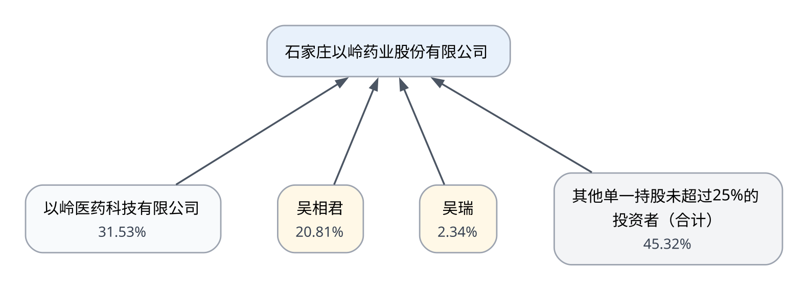

# 石家庄以岭药业股份有限公司（002603.SZ）企业授信研究报告

> AI 生成研究初稿，基于公开资料，需由授信人员人工复核；本报告不构成正式授信审批意见或授信额度建议。

## 第一章：企业基本情况

### 一、企业概况与创立背景

石家庄以岭药业股份有限公司（证券代码002603，深圳证券交易所上市）注册地及经营主体位于河北省石家庄市，2025年度报告范围为合并口径，研究基准日为2026年10月28日。公司属于医药制造业，按照2025年年报的表述，其主营业务是专利创新中药的研发、生产和销售。

公司的起点可追溯至1992年。公司官网披露，公司于1992年6月16日创建；同期第三方媒体资料亦记载，1992年以“石家庄开发区医药研究所”的形式起步，创始团队以络病理论的系统研究为技术原点，最初的主打方向是心脑血管中药而非呼吸系统用药。公司官网同时称，公司首次系统构建络病理论体系，形成“理论—临床—新药—产业—教学”五位一体的运营模式，并称“中医络病诊疗方法”被列入国家级非物质文化遗产。以上属于公司官方网站的自我表述，其中理论体系构建的首创性与非遗名录地位未取得独立权威来源交叉核实，使用时应视为公司口径。

从研究所到规范化股份公司经历了较长的组织演进。年报披露，公司系于2001年由“石家庄以岭药业有限公司”整体变更设立为股份有限公司，这一改制是公司治理与融资能力提升的关键节点，也为后续公开发行奠定了基础。

### 二、上市与资本市场历程

年报明确记载，公司股票于2011年7月28日在深圳证券交易所上市交易。上市使公司获得了产能建设、研发投入和市场网络扩张的资金来源。第三方媒体统计显示，从上市前2010年到2020年的十余年间，公司净资产由10.91亿元增至89.23亿元，营业收入由16.49亿元增至87.82亿元，净利润由不足3.15亿元增至12.19亿元；该组对比数据来自单一第三方媒体，可作为趋势参考，但不宜作为精确财务事实使用。

### 三、关键产品里程碑与业务演变

公司的发展史基本沿着“以络病理论为方法论、以专利中药为载体”的路径展开。根据第三方媒体记载，1996年公司主导产品通心络胶囊获批上市，成为公司最早形成规模的核心品种；此后参松养心胶囊（心律失常）、芪苈强心胶囊（慢性心衰）、连花清瘟胶囊（感冒与流感）陆续成为公司对外披露的主要产品。2025年年报列示的主要产品即为通心络胶囊、参松养心胶囊、连花清瘟胶囊、芪苈强心胶囊。公司官网另列示八子补肾胶囊等品种，并称已研发上市专利新药10余个、获得专利800余项。

公司业务边界在上市后逐步由单一专利中药扩展为多板块结构。公开资料显示，公司在专利中药之外布局了化生药与大健康板块：化生药方面，公司披露了“转移加工切入—仿制药国际国内双注册—专利新药研发生产销售”的分步发展战略，已持有18个美国ANDA产品批文，13个产品通过国内一致性评价，其全资子公司以岭万洲国际制药有限公司自主研发的化药专利新药苯胺洛芬注射液（商品名万舒安）获批上市用于术后镇痛；大健康板块则围绕呼吸健康与“通络、养精、动形、静神”方向开展健康产品与健康管理服务。上述板块划分与产品进展主要来自公司公开披露及媒体转述，其中化药与健康板块的收入贡献尚未在本次取得的资料中单独核实。

需要说明的是，就目前取得的资料，公司三十余年的主线仍是在络病理论框架下扩充专利中药品种，并同步向化药、大健康延伸。当前资料未发现公司发生主营业务方向意义上的重大业务转型；2024年至2025年之间出现的收入与利润大幅波动，从已披露信息看更接近产品结构与存货、收入冲减等经营层面的调整，而非业务赛道的更替。

### 四、当前行业与产业链定位

公司处于医药制造业中的中药细分赛道，核心环节是中药创新药（尤其是独家中成药）的研发、生产与销售，同时拥有化药制剂与原料的国际注册生产能力。在产业链上，公司扮演的是“中药制造与品牌运营方”的角色：上游连接中药材种植与流通、包材辅料及设备供应，下游连接医药商业流通企业与各级医疗机构终端，并通过自建学术推广体系影响终端处方。公司自述在河北、北京等地建有5个生产研发基地，并在全国建立了60余个中药材原材料基地，生产车间通过美国、欧盟、加拿大、新西兰等多个国家和地区的国际认证。

从产业角色看，公司上游承担的是对大宗中药材、包材与设备的质量与成本管理责任，下游承担的是产品学术推广、渠道维护与终端覆盖责任。至于上游供应商的具体构成、集中度与结算条件，以及下游客户结构、配送商与医院终端比例，公开资料披露有限，本次研究未取得可核实的名单或占比，需在后续尽调中补充。

### 五、初步授信视角观察

作为一家上市十五年的中药企业，公司具备较为完整的产品谱系、明确的学术推广路径和跨板块的产业布局，经营连续性较强。同时，公司业绩在2024年出现亏损、2025年大幅反转，说明其收入与利润对单一治疗领域的需求波动、渠道库存与产品有效期管理较为敏感，这一特征将在后续经营与财务章节进一步展开。

### 股权结构图

> 图示基于研究基准日已核实的公开披露关系，可能不代表完整股东名册或完整股权穿透。

## 第二章：经营情况分析

### 一、业务与产品结构

公司的主营业务是专利创新中药的研发、生产和销售。2025年年报列示的主要产品包括通心络胶囊、参松养心胶囊、连花清瘟胶囊、芪苈强心胶囊。从公开报道的产品板块口径看，2025年公司形成三类主要收入来源：心脑血管类产品、呼吸系统类产品以及其他专利产品。第三方财经媒体根据年报数据整理，2025年心脑血管类产品收入39.56亿元，占总营收比重50.52%；呼吸系统类产品收入20.17亿元，同比增长153.71%；其他专利产品收入4.58亿元，同比增长40.58%。这组分板块数据来自媒体对年报的整理，尚未在本次研究中与年报原文逐项核对，特别是口径是否含化生药与大健康板块尚不明确，因此宜作为结构性线索而非精确披露数据使用。

需要强调的是，本次研究未取得各单品的收入金额、销售占比或毛利贡献数据，年报口径下也缺少统一的分产品盈利披露。因此本报告不对产品集中度、单品依赖程度或某品种是否为利润主要来源作判断；上述问题属于待核实事项，需以年报“营业收入构成”附表及分部附注补充确认。

### 二、采购模式与上游管理

年报披露，公司根据所采物料特性采取多种采购模式，主要包括：

一是招标采购。对大宗物料（如大型设备、内外包材等）依据公司《招标管理办法》，通过以岭电子采购平台开展；需求部门提供需求计划和技术要求，询价部门进行价格征询和供应商筛选，供应商管理部门对供应商资格进行审查、确定合格供应商，再从公司专家库名单中抽取人员组成招标小组进行招标。这一机制表明公司对设备与包材类支出设置了内部授权与竞争性定价环节。

二是产地采购。对大宗中药材品种多采取药材产地采购模式，即通过前期市场及产区调研确定采购策略，选择时机进行产区季节性采购。中药企业的原材料成本对药材产区气候、产量与价格周期高度敏感，产地直采有助于缩短中间环节、稳定货源，但同时要求企业具备较高的行情判断与资金调度能力，季节性集中采购也会形成阶段性资金占用。

公司官网补充称，公司在全国建立了60余个中药材原材料基地。该表述为公司口径，基地的具体合作形式（自建、订单合作或协议采购）、权属与规模未在本次资料中披露。年报未披露前五大供应商名单、采购集中度和具体结算账期，因此不能推断公司对上游的议价地位。

### 三、生产与质量管理

公司在河北、北京等地建有5个生产研发基地，生产车间先后通过美国、欧盟、加拿大、新西兰等多个国家和地区的国际认证，并称建立了符合国际标准的全面质量管理体系。对于以院内处方为主的中成药企业，生产资质与质量标准是参与集中采购、进入医保和开拓海外注册的前提条件。公司未在本次取得的资料中披露产能规模、产能利用率及主要生产线分布，相关数据需以年报“生产能力”或募集资金使用情况章节补充。

### 四、销售模式与终端策略

年报明确表述，公司销售模式的核心竞争优势在于络病理论指导下的专业化推广模式。这意味着公司并非以单纯的渠道分销为主，而是通过学术理念输出、循证证据积累与医生教育来驱动处方，销售费用因此成为重要的成本项。2025年公司销售费用和管理费用同比分别下降15.88%和10.83%（媒体根据年报整理），在收入同比增长20.24%的同时费用下降，是当年利润修复的重要来源之一。费用率下降是否可持续，取决于推广活动的恢复节奏与合规要求，需结合后续期间费用披露持续跟踪。

公司产品的终端去向以医疗机构为主，通过医药商业企业配送；公司在2009年即已推动通心络胶囊在越南完成注册并进入当地医保目录，海外销售主要通过当地代理商开展。国内集采、医保目录调整与医院准入政策会直接影响产品的量价关系，这一点将在第三章展开。

### 五、盈利模式与关键驱动因素

从已披露信息看，公司的利润形成路径可概括为：以独家中成药或专利品种形成差异化定价基础，通过学术推广实现终端放量，在中药材采购、生产制造与渠道配送之间获取毛利，并以研发投入维持品种迭代。2025年毛利率为64.28%，较2024年的50.19%上升14.09个百分点。毛利率的显著改善既可能来自产品结构变化（如高毛利品种占比提升、低毛利或减值影响减弱），也可能与2024年呼吸系统产品冲减收入、计提存货减值形成的低基数有关；具体归因未在本次资料中获得公司逐项说明，属于需进一步核实的事项。由于缺少行业可比基准，本报告不对该毛利率水平作“高毛利”或“行业领先”的定性判断。

盈利模式中值得授信关注的两个结构性因素：其一，公司收入对心脑血管与呼吸系统两类治疗领域的终端需求较为敏感，呼吸系统用药具有明显的季节性甚至事件驱动特征，需求回落时容易形成渠道与存货压力；其二，公司维持较高的研发投入强度，2025年研发投入7.88亿元，占营业收入10.07%，属于刚性较强的现金支出，对现金流的连续性提出要求。

### 六、近期经营表现

2025年公司实现营业收入78.31亿元，同比增长20.24%；归属于上市公司股东的净利润12.86亿元，扣除非经常性损益后为12.22亿元；经营活动产生的现金流量净额17.76亿元（媒体口径为17.77亿元），公司说明主要因报告期内销售回款较同期增加。进入2026年，公司披露的一季度营业收入24.40亿元，同比增长3.46%，归母净利润4.09亿元，同比增长25.43%；第三方报道显示2026年上半年归母净利润同比增长13.28%。上述2026年数据来自外部媒体与公告摘要，属研究基准日前的已发生事项，未经本次研报的年报原文核验，可作为经营趋势的参考。

综合看，公司经营已从2024年的收入下滑与亏损中恢复，但恢复的可持续性取决于呼吸系统产品需求能否稳定、心脑血管品种能否维持份额，以及费用管控是否具有持续性。

## 第三章：行业环境与政策分析

### 一、所处行业与细分赛道

公司所处的医药制造业中，中药板块兼具消费品属性与监管强约束特征。以岭药业所在的中药创新药赛道，核心竞争要素包括独家中药品种的资源禀赋、循证医学证据的积累、医保与基药目录的准入资格、医院终端覆盖能力以及中药材成本控制能力。公司主攻的心脑血管中成药属于需求刚性强、患者基数大但竞争激烈的领域，呼吸系统用药则具有较强的季节性和疫情等事件驱动特征。

在竞争格局方面，第三方行业数据（米内网，经媒体转引）显示，公立医疗端心血管疾病中成药口服制剂市场集中度稳步提升，前十大产品市场份额由2015年的50.2%升至2020年的53.32%；公司通心络胶囊、参松养心胶囊、芪苈强心胶囊三个品种的合计份额由2015年的13.6%升至2020年的15.8%。该数据为2020年截面数据，且来源单一，仅用于说明该细分领域存在头部集中趋势，不能直接外推至2025年的市场地位。竞争对手方面，国内同仁堂、华润三九、步长制药、天士力等企业同样布局心脑血管中成药，行业整体在2024年经历了需求回落与集采、医保控费带来的降价压力。

### 二、产业链上下游环境

上游方面，中药材供应受产区气候、种植面积与价格周期影响明显。政策层面正在推动中药材流通与储备体系建设：国务院办公厅2025年3月印发的《关于提升中药质量促进中医药产业高质量发展的意见》（国办发〔2025〕11号）提出，指导建设产地加工基地、推广产地仓，缩减产区向生产、流通企业供应的中间环节；加强中药材市场管理，规范流通秩序，开展“丰储欠补”稳定市场供应；完善中药材价格监管机制，打击哄抬价格行为；并指导企业在大宗中药材产地建设储备库。对以产地采购为主要模式之一的企业而言，这些措施在方向上有利于稳定货源与价格，但储备库建设与产地仓布局也意味着企业需要在仓储与资金上作出投入，具体影响需结合公司自身采购政策核实。

下游方面，中药产品的终端需求受医保支付、医院准入与临床指南影响。《中医药振兴发展“十五五”规划》（国中医药规财发〔2026〕8号，2026年7月印发，属研究基准日前已发布的外部政策）提出促进医疗、医保、医药协同发展，优化中医药价格形成机制，完善中药采购政策，推进中药创新药临床应用，健全符合中医药特点的医保支付方式并深化中医优势病种按病种付费试点；同时完善“三结合”审评证据体系，加强中药上市后研究与评价。这意味着拥有循证证据与独家品种的企业在目录准入与临床推广上具备相对优势，但支付端控费仍会约束价格空间。

### 三、准入与评价政策

国办发〔2025〕11号文在临床价值与配备使用方面提出：利用循证医学等手段强化临床价值评估，构建中成药临床综合评价指标体系，并有序推动评价结果与国家基本药物目录、国家医保目录调整协调联动；鼓励开展已上市中成药评价研究以提升证据等级。在配备使用上，要求优化中药集中采购、招标采购政策实现优质优价，推动中成药全过程赋码监测，促进道地药材、中药创新药、中药改良型新药和古代经典名方复方制剂的配备使用。

这一政策取向对以岭药业具有双向含义。有利的一面是，公司多年投入循证研究、主要品种均有国际期刊发表证据，与“以临床价值为导向”的评价体系方向一致；2026年公司披露“中药创新价值获基药目录印证”的信息，亦显示其品种在目录层面的准入进展，但该表述来自媒体标题，具体品种与目录版本需以主管部门文件核实。不利的一面是，“优质优价”与临床综合评价同时意味着价格虚高或证据不足的品种面临被调整的风险，且评价结果与医保目录联动的机制会增加目录续约的不确定性。

### 四、集采与价格机制

中成药集中带量采购已进入常态化阶段。根据公开信息，全国中成药采购联盟已开展多批集中采购，2025年2月公布了相关批次的中选结果，2026年4月第四批全国中成药联盟采购开标，纳入28个采购组89种药品，全国4万余家医药机构参与报量。上述具体批次信息来自国家医保局网站检索摘要，因该页面在本次研究中无法打开原文，采购规则、降价幅度与公司品种是否涉及均未核验。

从机制上看，集采对中药企业的影响体现为以量换价：中选可提升医院覆盖与销量确定性，但单价下降会压缩单位毛利；未中选则面临非集采市场份额被替代的风险。对于以院内处方为主、品种具有一定的独家属性的企业，集采影响相对温和，但具体到公司各品种的中选状态与降价幅度，公开资料未在本次研究中取得，属于重要的待核实事项。

### 五、质量与生产监管

监管方面，国家药监局于2025年8月发布《中药生产监督管理专门规定》（2025年第79号公告），自2026年3月1日起施行，其上位依据包括《国务院办公厅关于全面深化药品医疗器械监管改革促进医药产业高质量发展的意见》（国办发〔2024〕53号）与国办发〔2025〕11号文。该规定属研究基准日前已生效的监管规则，具体条款内容因原网页访问受限未取得全文，仅确认其发布与生效时间。对生产企业而言，中药生产专项监管通常意味着对药材来源、生产工艺、质量标准和全过程追溯的要求提高，合规成本上升，但同时也提高了行业进入门槛，有利于具备质量管理体系与基地资源的企业。公司自述生产车间通过多国国际认证，是否完全符合新规要求需在尽调中确认。

### 六、行业趋势小结与授信含义

综合政策与行业信息，中药行业当前处于“支持创新+强化监管+支付控费”并行的环境中：政策鼓励中药创新药与道地药材使用，强化临床价值评价，同时通过集采和医保支付方式改革约束价格。对于以岭药业这类以独家专利中药为主、研发投入强度较高的企业，行业环境总体有利于其依靠证据与品种壁垒维持份额，但收入对目录调整、集采规则与终端需求的敏感度较高。授信视角下，应重点关注政策变动对主力品种量价的影响、中药材价格波动对成本的传导，以及监管新规可能带来的合规与资本开支压力。

## 第四章：财务分析

### 一、分析口径说明

本章财务数据基于公司2025年度合并财务报表，比较期间为2024年度与2025年度，金额单位为人民币元。所有金额、同比变化率与财务比率均来自结构化核验数据，未作重新计算。由于仅有两年可比数据，本章不对长期趋势、连续多年变化或稳定性作出结论。

### 二、盈利能力

2025年公司实现营业收入78.31亿元（7,830,737,438.74元），较2024年的65.13亿元（6,512,734,471.77元）增加13.18亿元，同比增长20.24%，触及重点分析阈值。归属于上市公司股东的净利润为12.86亿元（1,286,478,662.67元），上年同期为亏损7.25亿元（-724,515,582.24元），实现由亏转盈；扣除非经常性损益后的净利润为12.22亿元（1,221,723,222.61元），上年同期为-7.92亿元，同样由负转正。基本每股收益与加权平均净资产收益率亦同步回升，加权平均净资产收益率由2024年的-6.69%升至2025年的11.99%。

收入与利润的反转幅度较大，说明公司业绩具有较强的弹性。关于反转原因，本次取得的核验数据中未包含公司对利润变动的直接披露原因；外部媒体在解读时提及2024年亏损与呼吸系统产品临近有效期冲减收入、计提存货减值有关，2025年则受益于呼吸系统类产品收入回升与费用下降。上述解释来自媒体转述，尚未与年报原文及附注逐项核对，属于待核实线索，不能作为公司已披露原因的确认表述。

毛利率方面，2025年为64.28%，2024年为50.19%，上升14.09个百分点。这一变化方向与收入结构改善、减值与收入冲减因素消退的假设相容，但公司未在本次资料中给出毛利率变动的量化归因。由于缺少行业可比基准，本报告不对该水平的行业相对位置作定性判断。毛利率能否维持在现有水平，取决于产品结构、集采价格与中药材成本三者的共同作用，需持续跟踪。

### 三、现金流与利润的匹配度

2025年经营活动产生的现金流量净额为17.77亿元（1,776,508,378.47元），较2024年的6.11亿元（611,013,171.11元）增加11.65亿元，同比增长190.75%，为各科目中变化幅度最大的一项。公司公开说明该增长主要因报告期内销售回款较同期增加。以经营活动现金流量净额与归母净利润对比，2025年经营现金流明显高于净利润，显示当期利润具有较好的现金支撑；但2024年经营现金流为正而净利润为负，说明两者之间存在存货减值、收入冲减等非现金项目的显著影响，因此不宜简单以单年比值判断利润质量。

销售收现比由2024年的113.23%降至2025年的108.44%，下降4.79个百分点，但仍高于100%，表明销售商品、提供劳务收到的现金总体覆盖营业收入。收现比的小幅下降可能与收入结构、含税口径、预收与应收结算节奏有关，现有证据不足以证明存在非现金结算扩大、回款恶化或账期延长，相关假设需以应收账款账龄和期后回款数据核实。

### 四、资产结构与营运资金

2025年末公司总资产136.75亿元（13,674,998,496.95元），较2024年末133.19亿元增长2.67%；归属于上市公司股东的净资产109.89亿元（10,989,102,712.08元），增长7.49%。

流动资产合计由43.35亿元增至52.06亿元，增加8.71亿元，同比增长20.10%，触及重点分析阈值。就已取得的科目看，货币资金增加2.52亿元，对流动资产增量的贡献率为28.92%；应收账款增加0.03亿元；预付款项增加0.18亿元；存货减少2.58亿元。上述已列示科目的净变动合计仅约0.16亿元，尚有约8.56亿元的流动资产增量未被这些科目覆盖，可能来自交易性金融资产、其他流动资产、应收款项融资或一年内到期的非流动资产等未纳入本次快照的项目。因此不能将流动资产增长主要归因于货币资金，也不能把剩余增量推定至任何单一科目，需以完整资产负债表核实。

货币资金由8.53亿元增至11.05亿元，增加2.52亿元，同比增长29.53%。在同期短期借款为零、经营现金流大幅为正的情况下，货币资金的增长与经营积累方向一致。但公开资料未披露期末货币资金的受限金额、存放银行与币种结构，因此不能得出“可自由动用资金充足”的确定结论。

应收账款由12.25亿元微增至12.29亿元，同比增长0.28%，增幅远低于营业收入20.24%的增速，两者方向不完全同步，说明当期收入增长并未以应收账款显著扩张为代价，这一点对回款质量是正面信号。但应收账款绝对额仍超过12亿元，约占全年营业收入的15.7%（该比例为期末余额与全年收入之比，非周转率），其客户集中度、账龄结构、坏账准备计提与期后回款情况均未取得，仍需重点核查。

存货由17.46亿元降至14.89亿元，减少2.58亿元，同比下降14.76%。在收入同比增长的同时存货下降，可能反映渠道库存消化、存货减值计提或生产节奏调整。考虑到2024年公司曾因呼吸系统产品临近有效期而冲减收入并计提存货减值（媒体转述，待核实），存货下降的构成中减值与正常销售的去化比例是判断未来是否仍有减值风险的关键。

预付款项由0.53亿元增至0.71亿元，增加0.18亿元，同比增长34.21%。绝对金额较小，对整体资金占用影响有限。其增长可能与中药材产地采购的季节性预付、包材或设备采购的预付安排有关，但公司未披露主要预付对象与合同背景，属于待核实事项。

应付账款由18.47亿元降至14.68亿元，减少3.78亿元，同比下降20.49%，触及重点分析阈值。应付账款下降意味着公司以更快的速度向供应商付款，这会消耗经营现金流；在同期经营现金流大幅改善的背景下，两者并不矛盾，反而说明公司现金流足以支撑更及时的付款。应付账款下降也可能反映采购规模变化或结算方式调整。需关注是否存在对供应商的集中付款压力，以及未来若采购扩大是否会导致应付账款回升、进而对资金形成新的占用。

需要指出，本次资料未提供应收、存货、应付、预付及其他经营性科目的完整变动桥接，因此只能就局部科目作方向性描述，不能断言营运资金占用总体改善或收敛。

### 五、偿债能力与资本结构

2025年末资产负债率为19.69%，较2024年末的23.40%下降3.71个百分点；流动比率由166.30%升至235.76%，提升69.46个百分点。两个指标同向改善，反映公司负债规模相对收缩、短期偿付缓冲增强。

短期借款在2024年末与2025年末均为零，属于基期为零、无可比同比的情形。这意味着公司在有息短期负债层面暂无到期集中兑付压力，结合11.05亿元的货币资金与17.77亿元的经营现金流，短期流动性状况在账面层面较为宽松。但需注意：短期借款为零并不等于无有息负债，一年内到期的非流动负债、应付债券、租赁负债及其他带息项目未纳入本次数据；同时货币资金的受限部分亦未披露。因此，本报告不对“流动性充足”或“现金短债比安全”作出确定结论。

### 六、专项结论

盈利与收入质量方面：2025年收入与利润同步大幅回升，经营现金流高于净利润，收现比维持在100%以上，显示当期盈利具备现金支撑；但公司对2024年的亏损与2025年的反转均缺少经核验的量化原因披露，利润的可持续性有待后续期间数据验证。

营运资金方面：应收账款基本持平、存货下降、应付账款减少，构成局部积极信号；但缺少完整的营运资金变动桥接，且流动资产增量中有约8.56亿元未被已列示科目覆盖，无法对整体资金占用状况下结论。

短期偿债与现金流方面：资产负债率低、流动比率高、短期借款为零，账面偿债压力较小；但受限资金、有息负债全貌与债务期限结构未取得，需在尽调中补齐后再评价真实偿付能力。

重大财务异常方面：本次核验数据未发现货币资金与收入、现金流之间的明显背离；主要的不确定性集中在毛利率大幅提升的原因、存货减值的充分性以及流动资产未解释增量三处。

公开信息局限方面：本章仅覆盖两个会计年度，未取得分产品收入与毛利、附注级明细、受限资产清单及审计意见细节，相关结论应视为初步判断。

### 重点财务数据

金额单位：人民币亿元；同比由 Python 基于已核验年报数据计算。

| 科目 | FY2024 | FY2025 | 同比变化 |
|---|---:|---:|---:|
| 应付账款 | 18.47 | 14.68 | -20.49% |
| 应收账款 | 12.25 | 12.29 | 0.28% |
| 流动资产合计 | 43.35 | 52.06 | 20.10% |
| 存货 | 17.46 | 14.89 | -14.76% |
| 货币资金 | 8.53 | 11.05 | 29.53% |
| 经营活动产生的现金流量净额 | 6.11 | 17.77 | 190.75% |
| 营业收入 | 65.13 | 78.31 | 20.24% |
| 预付款项 | 0.53 | 0.71 | 34.21% |
| 短期借款 | 0.00 | 0.00 | 不适用（跨符号或基期不可比） |

### 核心财务比率

| 指标 | FY2024 | FY2025 |
|---|---:|---:|
| 资产负债率 | 23.40% | 19.69% |
| 流动比率 | 166.30% | 235.76% |
| 毛利率 | 50.19% | 64.28% |
| 销售收现比 | 113.23% | 108.44% |

## 第五章：综合授信风险分析

### 一、风险识别框架

本章将前文的经营、行业政策与财务三个维度交叉关联，识别对公司偿债能力与银行授信安全产生影响的主要风险。需要说明，本章是研究判断，不构成授信额度建议或审批意见。

### 二、经营与财务的联动风险：业绩波动幅度大

2024年公司营业收入65.13亿元、归母净利润亏损7.25亿元，2025年收入回升至78.31亿元、归母净利润12.86亿元，一年之内完成由亏转盈。从财务数据本身可以确认的是波动幅度，而波动的成因在本次资料中仅有媒体转述（呼吸系统产品临近有效期冲减收入、存货减值，以及2025年呼吸系统产品收入回升与费用下降），尚未获得年报原文确认。

对授信的含义体现在两点。第一，公司利润对单一治疗领域的终端需求变化敏感，呼吸系统用药的季节性与事件驱动特征会直接传导至收入、存货和减值计提；第二，在需求回落期，公司需要同时承受收入冲减、存货跌价与渠道库存清理三重压力，这可能引发现金流的阶段性收紧。2024年经营现金流仍为正（6.11亿元）而净利润为负，说明当年的现金层面抗压能力好于利润表表现，这是相对积极的信号。但由于仅有两年数据，不能据此判断公司已具备穿越完整行业周期的稳定性。

### 三、政策与经营的联动风险：准入与价格的双重不确定性

行业政策环境总体支持中药创新，但支付端约束在加强。国办发〔2025〕11号文推动临床综合评价结果与基药目录、医保目录联动，并优化中药集采、招标采购政策以实现优质优价；《中医药振兴发展“十五五”规划》继续推进医保支付方式改革与中医优势病种按病种付费试点。对公司的直接影响路径是：主力品种的目录准入状态决定终端可及性，集采中选状态与价格决定单位毛利。2025年毛利率提升14.09个百分点，本身说明公司盈利能力对结构与价格变化高度敏感，一旦集采扩围至公司主力品种且降幅较大，现有毛利水平可能承压。目前未取得公司各品种的集采中选与降价数据，该风险的方向可判断、幅度不可量化，属需重点核实事项。

此外，中药材价格是成本端的重要变量。国办发〔2025〕11号文提出完善中药材价格监管机制、打击哄抬价格，并鼓励企业在大宗药材产地建设储备库，这些措施在方向上有助于平抑价格，但企业为满足产地直采与储备要求可能增加存货与仓储资金占用。2025年存货已由17.46亿元降至14.89亿元，若未来为保障供应而重建库存，将形成新的营运资金需求。

### 四、财务维度的风险与缓释因素

缓释因素方面：2025年末资产负债率19.69%、流动比率235.76%、短期借款为零，账面资本结构与短期偿付缓冲较为稳健；经营活动现金流量净额17.77亿元，同比增长190.75%，为研发投入与股利分配提供了现金基础；应收账款同比仅增长0.28%，明显低于收入增速，未出现依靠放宽信用换取收入扩张的迹象。

需要关注的因素方面：其一，货币资金11.05亿元，但受限金额与存放结构未披露，实际可动用资金规模未知；其二，本次数据未覆盖一年内到期的非流动负债、应付债券及租赁负债等带息项目，有息负债的全貌与期限结构尚不清晰，短期借款为零不能被解读为无债务压力；其三，流动资产本年增加8.71亿元，其中约8.56亿元未被已列示科目覆盖，该部分资产的流动性与变现能力不明，若其中包含变现能力较弱的项目，流动比率的高位可能存在高估；其四，毛利率大幅提升的原因未获公司量化说明，若主要来自低基数与减值因素消退而非结构性改善，则未来毛利率存在回归压力。

### 五、研发投入与资本开支的资金需求

2025年公司研发投入7.88亿元，占营业收入10.07%（媒体根据年报整理）。研发支出具有刚性、周期长、失败风险高的特点，且在新药获批后仍需持续投入市场推广。同时公司披露2025年度利润分配预案为每10股派发现金红利5元，合计约8.35亿元（媒体口径）。研发投入、股利分配与潜在的产能建设共同构成现金流出，需要稳定的经营现金流支撑。2025年17.77亿元的经营现金流覆盖这些支出尚有余量，但若收入回落至2024年水平，现金流的缓冲空间将明显收窄。授信安排上应关注资金用途与现金流的匹配节奏，避免以短期融资支撑长期研发与资本开支。

### 六、治理与合规维度的审慎提示

本次研究未取得明确原文支持的控制权变更、资金占用、重大关联交易或股权质押等重大治理风险事件，因此不对公司治理状况作风险认定。但从业务性质看，医药企业普遍面临销售合规、学术推广费用真实性、产品质量与药品追溯等监管要求，国办发〔2025〕11号文提出推动中成药全过程赋码监测，国家药监局《中药生产监督管理专门规定》自2026年3月1日施行，均可能带来合规成本上升。相关影响程度需在尽调中结合公司实际执行情况评估。

### 七、综合判断

从银行授信角度，公司当前呈现“低杠杆、高流动性、强现金回流”的财务表象，与“业绩年度间波动大、政策敏感度高、品种集中度不明”的经营特征并存。前者提供了较好的风险缓冲，后者决定了对未来现金流预测的不确定性。授信结构上宜以与经营周期匹配的短期流动资金品种为主，对中长期资金需求应结合项目现金流与资本开支计划单独评估；同时应将集采中选情况、主力品种目录状态、受限资金与有息负债全貌列为首要核实事项，在补齐上述信息前不宜对公司的长期偿债能力作出乐观结论。

## 第六章：待补充资料及尽调问题

### 一、尽调重点说明

本章将前文各章识别出的信息缺口转化为可供银行实地核查的问题清单。问题按财务、经营、政策合规与治理四个方向归集，均与前文风险点对应。

### 二、财务类核查

货币资金方面，需核实期末11.05亿元货币资金中受限部分（保证金、票据保证金、冻结存款等）的金额与性质，主要开户行与账户余额分布，是否存在存放于非银行金融机构的资金，以及境外资金占比与调回限制。这是判断实际可动用流动性的前提。

有息负债全貌方面，短期借款两年均为零，需进一步核实一年内到期的非流动负债、应付债券、租赁负债、长期借款及其他带息项目的余额、期限结构与利率，以及是否存在对外担保、票据承兑等或有负债。同时应取得企业征信报告，核对银行借款明细与担保方式。

应收账款方面，需取得前五大欠款方及其关联关系、账龄结构、逾期余额、坏账准备计提政策与计提比例，以及2025年末至核查日的期后回款情况。重点判断12.29亿元应收账款的实际可回收性，以及在收入增长20.24%而应收仅增0.28%的情况下，是否存在保理、票据贴现或应收账款融资等出表安排。

存货方面，需取得存货的构成明细（原材料、在产品、库存商品）、库龄分布与近效期产品金额、2025年计提的存货跌价准备金额及转销情况。结合2024年因呼吸系统产品临近有效期冲减收入与计提减值的情况，判断2025年末14.89亿元存货是否已充分计提，以及未来是否存在进一步减值风险。

应付账款方面，需核实应付账款由18.47亿元降至14.68亿元的具体原因，主要供应商名单与账期约定，是否存在逾期未付或集中付款安排，以及采购规模与存货、营业成本变动的匹配关系。

流动资产未解释增量方面，2025年流动资产增加8.71亿元，已列示科目仅解释约0.16亿元，需取得完整资产负债表与附注，明确剩余约8.56亿元增量的具体科目构成及其流动性与可变现性。

毛利与费用方面，需取得公司对2025年毛利率由50.19%升至64.28%的量化说明，包括产品结构、单位成本、价格与减值影响的分解；同时核实销售费用、管理费用分别下降15.88%、10.83%的具体原因及可持续性。

### 三、经营类核查

产品结构方面，需取得2025年年报“营业收入构成”表，核实心脑血管类、呼吸系统类、其他专利产品及化生药、大健康板块各自的收入、成本与毛利，确认媒体转述的39.56亿元、20.17亿元、4.58亿元数据与年报口径是否一致，并据以判断产品集中度与各板块的利润贡献。

单品层面，需核实通心络胶囊、参松养心胶囊、芪苈强心胶囊、连花清瘟胶囊各自的销售额与增速，评估是否存在对单一品种的依赖，以及呼吸系统产品在2025年高增长后的需求可持续性。

销售与渠道方面，需了解主要配送商业企业与终端覆盖结构（等级医院、基层、零售），销售返利与信用政策，应收账款的结算方式，以及学术推广活动的组织形式与费用结算方式，评估销售合规风险。

产能与生产方面，需取得主要生产基地的产能、产能利用率、主要产品生产线布局及未来资本开支计划，判断是否存在产能闲置或扩产带来的资金需求。

采购与上游方面，需核实公司自述的60余个中药材原材料基地的合作模式与权属，主要中药材品种的价格走势与采购策略，前五大供应商集中度及结算账期，评估成本波动与供应中断风险。

### 四、政策与合规类核查

集采方面，需核实公司主要品种在国家及省级中成药集中带量采购中的中选情况、中标价格与降价幅度、约定采购量及执行周期，评估量价变化对收入与毛利的影响。

目录准入方面，需核实各主要产品在国家医保目录、国家基本药物目录中的收录状态与甲乙类分类，2026年基药目录调整中公司品种的纳入情况，以及是否存在被调出、限定支付范围或纳入重点监控目录的情形。

监管合规方面，需核实公司对《中药生产监督管理专门规定》（2026年3月1日施行）的准备情况与合规成本，是否发生药品质量不合格、飞行检查缺陷、召回或行政处罚事件，GMP证书与主要产品批文的有效性。

### 五、治理与其他

需核实公司是否存在控股股东及关联方资金占用、重大关联交易、股权质押或冻结、控制权变动等事项，取得最近一年的审计报告与内部控制审计意见，确认是否存在非标准无保留意见或关键审计事项提示。此外，需取得2026年最新的季度或半年度财务数据，评估2025年的盈利修复是否延续，以及2025年度利润分配方案的实施对现金流的影响。

### 六、资料缺口对结论的影响

本次研究仅使用了两期财务数据，未取得完整年报原文、附注明细、审计报告及公司对重大变动的直接说明；分产品收入、受限资金、有息负债全貌、客户与供应商集中度等关键信息均存在缺口。在上述资料补齐前，本报告的判断应视为基于有限公开信息的初步结论，不宜直接作为授信审批依据。

### 尽调问题清单

本次模型草稿未形成尽调问题清单。

### 研究限制与待补充资料

- 本次研究仅取得2024年度与2025年度两期可比财务数据，无法判断长期趋势、连续多年变化或业绩稳定性。
- 未能读取深圳证券交易所/巨潮资讯平台的2025年年度报告PDF原文，年报中营业收入构成、附注明细、审计意见及公司对重大变动的说明均未取得，相关分析依赖结构化核验数据与媒体转述。
- 未取得分产品收入金额与占比、分产品毛利及盈利贡献数据，因此未对产品集中度、单品依赖程度或主要利润来源作判断。
- 2024年亏损与2025年利润反转的原因（呼吸系统产品临近有效期冲减收入、存货减值、费用下降等）仅来自媒体转述，未经年报原文核实，报告中已标注为待核实。
- 2025年分板块收入数据（心脑血管类39.56亿元、呼吸系统类20.17亿元、其他专利产品4.58亿元）来自第三方媒体对年报的整理，未与年报原文逐项核对，口径是否含化生药与大健康板块尚不明确。
- 货币资金的受限金额、存放银行、币种结构，以及除短期借款外的有息负债全貌与期限结构均未取得，不能得出流动性充足或无债务压力的确定结论。
- 2025年流动资产增加8.71亿元中约8.56亿元未被已列示科目覆盖，无法归因至具体科目，流动资产结构与流动比率的质量存在不确定性。
- 缺少完整的应收、存货、应付、预付及其他经营性科目变动桥接，不能断言营运资金占用总体改善或收敛。
- 缺少行业可比基准，未对64.28%的毛利率水平作高毛利或行业领先的定性判断。
- 全国中成药集采批次、降价幅度及公司品种中选情况未能取得原文，相关影响方向可判断但幅度不可量化。
- 国家药监局《中药生产监督管理专门规定》与国家医保局网站相关页面访问受限，仅确认发布时间与生效日期，未取得条款全文。
- 公司治理方面未取得控制权变更、资金占用、重大关联交易、股权质押等事项的明确原文，因此未作相关风险认定。
- 2026年一季度及上半年经营数据来自外部媒体与公告摘要，未经本次研究的年报原文核验。
- 公司官网关于络病理论首创性、非遗名录地位、中药材基地数量等表述为公司单方口径，未取得独立权威来源交叉核实。
- fetch_network_error
- access_restricted
- 网页原文读取次数已达到本次运行预算上限，未读取候选仍待核实。

---

原始年报、网页 URL、结构化数据、Skill 加载记录及执行轨迹已独立保存在后台研究产物中。
