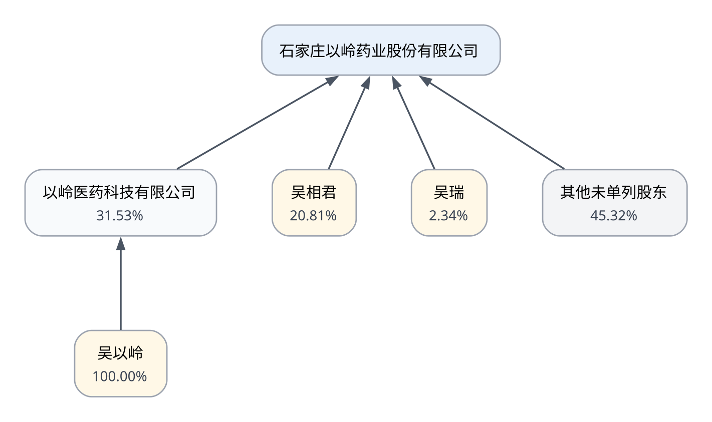

# 石家庄以岭药业股份有限公司公开信息授信研究报告（初稿）

> 证券代码：`002603.SZ`　|　报告生成时间：2026-10-23T00:47:04.366527+00:00
> 本报告仅基于公开信息，未经企业尽调确认，不构成授信审批、额度或定价建议。
> 当前版本不包含财务分析和行业政策研究；相关内容将在 V2 阶段补充。

## 1. 企业基本信息

| 项目 | 内容 |
| --- | --- |
| 上市主体 | 石家庄以岭药业股份有限公司 [S01] |
| 证券简称 | 以岭药业 [S01] |
| 证券代码 | 002603.SZ [S01] |
| 上市地点 | 深圳证券交易所 [S01] |
| 研究口径 | 上市公司合并口径 |

## 2. 企业发展历史

- 公司披露其于2001年由石家庄以岭药业有限公司整体变更设立。 [S01]
- 公司股票于2011年7月28日在深圳证券交易所上市交易。 [S01]
- 2025年年报披露，公司上市以来主营业务无变更。 [S01]

## 3. 主营业务与经营模式

### 3.1 主营业务

- 公司的主营业务是专利创新中药的研发、生产和销售。 [S01]
- 公司披露已构建专利中药、化生药和健康产业协同发展的业务格局。 [S01]

### 3.2 经营模式

- 公司披露招标采购为采购模式之一。 [S01]
- 公司披露集中采购为采购模式之一。 [S01]
- 公司披露产地采购为采购模式之一。 [S01]
- 公司披露议价采购为采购模式之一。 [S01]
- 公司按照药品生产质量管理规范组织生产，并以市场和客户需求作为制定生产计划的依据之一。 [S01]
- 公司披露其销售模式的核心竞争优势在于络病理论指导下的专业化推广模式。 [S01]
- 公司产品主要通过合作的医药流通企业对外配送销售。 [S01]
- 公司的研发模式主要包括自主研发和合作研发两种模式。 [S01]

## 4. 主要产品

- 年报将通心络胶囊列为公司主要产品。 [S01]
- 年报将参松养心胶囊列为公司主要产品。 [S01]
- 年报将连花清瘟胶囊列为公司主要产品。 [S01]
- 年报将芪苈强心胶囊列为公司主要产品。 [S01]

## 5. 股权结构图

股权结构基准日为 **2025-12-31**。

### 股权比例完整性校验

- 石家庄以岭药业股份有限公司：已知比例合计 54.68%；通过（含经核验差额计算）。[S01]
- 以岭医药科技有限公司：已知比例合计 100.00%；通过。[S01]

## 6. 主要股东及实际控制关系

### 6.1 直接持股情况

- 其他未单列股东：45.32%（Python差额计算值） [S01]
- 以岭医药科技有限公司：31.53% [S01]
- 吴相君：20.81% [S01]
- 吴瑞：2.34% [S01]

### 6.2 控制关系

- 以岭医药科技有限公司为石家庄以岭药业股份有限公司的控股股东。[S01]
- 吴以岭、吴相君、吴瑞为石家庄以岭药业股份有限公司的实际控制人。[S01]
- 吴以岭、吴相君、吴瑞之间存在一致行动关系，控制对象为石家庄以岭药业股份有限公司。[S01]
- 吴以岭为石家庄以岭药业股份有限公司的最终控制方。[S01]

### 6.3 AI 辅助分析状态

> 本次报告未调用 LLM；正文由 Python 根据已验证结构化事实确定性生成。

## 7. 待核查事项

- 前身企业早期沿革：本阶段证据可确认2001年整体变更设立和2011年上市，但未确认前身企业最初设立日期及2001年前的完整沿革。（原因：当前经核验的年报原文锚点未提供完整早期时间线，不能根据公司名称或第三方材料补造。）
- 统一盈利模式：本阶段已核实采购、生产、销售和研发模式，但尚未取得足以定义统一盈利模式的直接披露证据。（原因：不能仅凭业务板块或销售方式推断利润形成机制、定价方式和利润来源。）
- 单品收入与占比：本阶段已核实主要产品名称，但尚未从V1.1证据中确认各单品收入、收入占比和盈利贡献。（原因：产品名称披露不能替代财务分部或单品收入数据；相关金额应在后续有来源的数据结构化后单独核验。）
- 完整股东名册：当前公开证据仅核实控制链、主要直接持股及其他未单列股东的合计比例，未形成覆盖全部股东身份的完整股东名册。（原因：年报披露的是持股5%以上股东或前10名股东；差额只代表其他未单列股东合计，不能据此推断其具体身份或各自比例。）
- 产权及控制关系方框图的图像文本：PDF文本层未提取出年报方框图内部文字，本阶段以同份年报股东表和财务报表附注交叉核实控制链。（原因：该页方框图为图像对象，当前V0 PDF文本接口未提供图像OCR。）
- 企业基本面事实仅来自当前种子目录中已完成精确原文匹配的2025年年报内容。
- 本阶段未调用LLM，inferences为空；不得把人工归纳或常识自动写成公司事实。
- missing_information表示当前证据链尚未确认，不等同于年报或企业绝对未披露。
- 本结果仅基于公开信息，未经企业尽调确认，不构成授信审批结论。
- 本图是截至2025年12月31日、基于S01年报同口径数据形成的股权穿透图，不是完整股东名册。
- 目标公司未逐项列示部分以‘其他未单列股东’展示，其比例为100%减去已核实主要股东比例的确定性计算值；该节点不代表某一具体股东。
- 持股关系、实际控制人、一致行动关系和最终控制方分别建模，不以比例自动推断控制权。
- 财务分析尚未进入 V2，当前报告不能据此判断偿债能力或现金流风险。
- 行业发展及政策研究尚未进入 V2，当前报告未评价行业周期和政策影响。

## 8. 数据来源及引用附录

- [S01] 石家庄以岭药业股份有限公司2025年年度报告；发布者：巨潮资讯网（上市公司公告）；披露日期：2026-04-28；报告期：FY2025；PDF页码：6、10、27、28、97、98、99、100、128、217；定位：第七节 股份变动及股东情况 / 三、公司实际控制人及其一致行动人；第七节 股份变动及股东情况 / 三、公司控股股东情况；第七节 股份变动及股东情况 / 三、股东关联关系或一致行动说明；第七节 股份变动及股东情况 / 三、股东和实际控制人情况；第三节 管理层讨论与分析 / 一、主要业务 / （三）经营模式 / 生产模式；第三节 管理层讨论与分析 / 一、主要业务 / （三）经营模式 / 研发模式；第三节 管理层讨论与分析 / 一、主要业务 / （三）经营模式 / 采购模式；第三节 管理层讨论与分析 / 一、主要业务 / （三）经营模式 / 销售模式；第三节 管理层讨论与分析 / 一、报告期内公司从事的主要业务；第二节 公司简介和主要财务指标 / 一、公司信息；第二节 公司简介和主要财务指标 / 四、注册变更情况；第十二节 财务报告 / 三、公司基本情况 / 2、企业的业务性质和主要经营活动；第十二节 财务报告 / 三、公司基本情况 / （一）公司概况；第十二节 财务报告 / 十四、关联方及关联交易 / 1、本企业的母公司情况；第十二节 财务报告 / 十四、关联方及关联交易 / 4、其他关联方情况；原文：https://static.cninfo.com.cn/finalpage/2026-04-28/1225205683.PDF

---

本报告为 V1.4 初版，信息范围与限制以上述来源、基准日和待核查事项为准。
